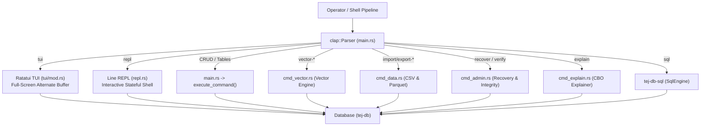
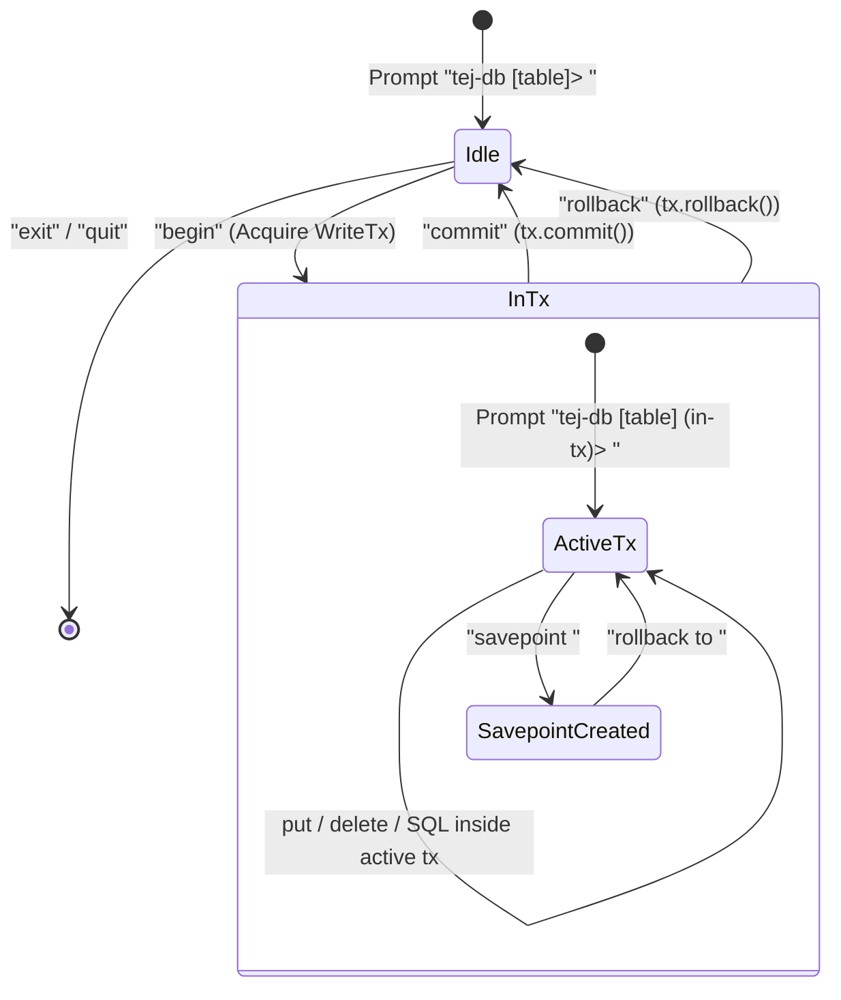
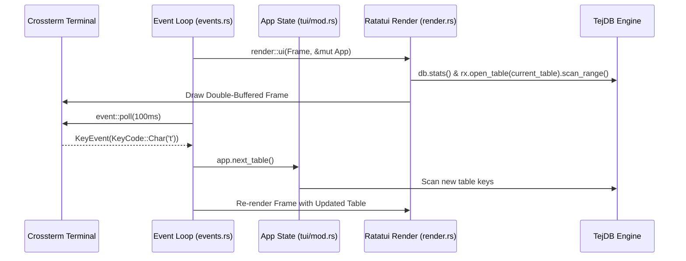

# `tej-db-cli`: Interactive TUI, REPL Shell & Administration CLI for TejDB

[](https://crates.io/crates/tej-db-cli)
[](https://docs.rs/tej-db-cli)
[](LICENSE)
[]()

`tej-db-cli` is the unified operator terminal, administration tool, and interactive inspection shell for the `tej-db` modular ACID embedded database ecosystem. It combines an automated command-line interface (CLI) for scripting and pipeline automation, an interactive line-by-line REPL shell with multi-statement ACID transactions and automatic SQL detection, and a full-screen graphical Terminal User Interface (TUI) powered by `ratatui` and `crossterm`.

From low-level key-value mutations and multi-table keyspace management to RaBitQ vector indexing, k-NN similarity search, Apache Parquet / CSV data ingestion, SQL Cost-Based Optimizer (CBO) plan inspection, and crash recovery, `tej-db-cli` provides an ergonomic, zero-friction operator experience.

---

## Table of Contents

1. [Executive Overview](#executive-overview)
2. [Folder & Source File Structure](#folder--source-file-structure)
3. [Architecture & Execution Modalities](#architecture--execution-modalities)
   - [Unified CLI & Subcommand Dispatch](#unified-cli--subcommand-dispatch)
   - [Stateful REPL Shell with Multi-Statement Transactions](#stateful-repl-shell-with-multi-statement-transactions)
   - [Graphical Ratatui TUI Architecture](#graphical-ratatui-tui-architecture)
4. [Command-Line Subcommand Reference](#command-line-subcommand-reference)
   - [Global Flags](#global-flags)
   - [Key-Value CRUD Subcommands](#key-value-crud-subcommands)
   - [Table & Keyspace Subcommands](#table--keyspace-subcommands)
   - [Vector Search & Indexing Subcommands](#vector-search--indexing-subcommands)
   - [Bulk Data Exchange (CSV & Parquet)](#bulk-data-exchange-csv--parquet)
   - [SQL Execution & CBO Plan Explanation](#sql-execution--cbo-plan-explanation)
   - [Administration, Verification & Crash Recovery](#administration-verification--crash-recovery)
5. [Interactive REPL Shell Deep-Dive](#interactive-repl-shell-deep-dive)
   - [Interactive ACID Transactions (`begin`, `commit`, `rollback`, `savepoint`)](#interactive-acid-transactions)
   - [Keyspace Navigation (`use <table_name>`)](#keyspace-navigation-use-table_name)
   - [Auto-Detected SQL Execution](#auto-detected-sql-execution)
   - [Built-In REPL Verbs](#built-in-repl-verbs)
6. [Graphical Ratatui TUI Deep-Dive](#graphical-ratatui-tui-deep-dive)
   - [Tab 1: Dashboard & Performance Topology](#tab-1-dashboard--performance-topology)
   - [Tab 2: Multi-Table Data Explorer & Hex Inspector](#tab-2-multi-table-data-explorer--hex-inspector)
   - [Tab 3: Transaction REPL Console](#tab-3-transaction-repl-console)
   - [Terminal Lifecycle & Raw Mode Safety](#terminal-lifecycle--raw-mode-safety)
7. [Mathematical Metrics & Benchmark Analysis](#mathematical-metrics--benchmark-analysis)
   - [Page Cache Hit Ratio Formulation](#page-cache-hit-ratio-formulation)
   - [Vector Similarity Search Latency & Recall](#vector-similarity-search-latency--recall)
   - [CLI Performance vs. SQLite & RocksDB](#cli-performance-vs-sqlite--rocksdb)
8. [Complete Production Recipes](#complete-production-recipes)
   - [Recipe 1: Quick Database Initialization & Table Setup](#recipe-1-quick-database-initialization--table-setup)
   - [Recipe 2: Shell Scripting & High-Throughput Batch Ingestion](#recipe-2-shell-scripting--high-throughput-batch-ingestion)
   - [Recipe 3: Creating Vector Indexes & Running k-NN Similarity Search](#recipe-3-creating-vector-indexes--running-k-nn-similarity-search)
   - [Recipe 4: CSV & Apache Parquet Data Import and Export](#recipe-4-csv--apache-parquet-data-import-and-export)
   - [Recipe 5: Inspecting SQL Execution Plans with CBO Explain](#recipe-5-inspecting-sql-execution-plans-with-cbo-explain)
   - [Recipe 6: Live Multi-Table Exploration via Graphical TUI](#recipe-6-live-multi-table-exploration-via-graphical-tui)
   - [Recipe 7: Crash Recovery, Integrity Verification & Hot Compaction](#recipe-7-crash-recovery-integrity-verification--hot-compaction)
9. [Verification & Quality Gates](#verification--quality-gates)

---

## Executive Overview

Modern embedded database systems demand multi-modal tooling accessible by both human operators and automated shell pipelines. `tej-db-cli` fulfills this requirement across three operational tiers:

1. **Automation & Scripting (Headless CLI)**:
   Every storage, transaction, vector, columnar, and SQL subsystem is directly accessible via structured subcommands. Shell scripts, batch pipelines, and continuous integration environments can execute isolated commands without background daemon dependencies.

2. **Interactive Developer Shell (REPL)**:
   A stateful, line-oriented read-eval-print loop designed for active administration. Supports explicit multi-statement ACID transactions (`begin`, `commit`, `rollback`, `savepoint`), keyspace navigation (`use <table_name>`), inline vector search (`vsearch`), and automatic SQL statement detection.

3. **Full-Screen Operator Dashboard (Ratatui TUI)**:
   A visual terminal dashboard utilizing alternate screen buffers and raw keyboard input. Includes real-time gauges of page cache efficiency, multi-table catalog navigation (`t` hotkey), a dual-pane hex/UTF-8 data inspector, and an integrated transaction console with microsecond execution timing.

---

## Folder & Source File Structure

In accordance with workspace rules (`AGENTS.md`), no file exceeds 500 lines. The CLI crate is decomposed into modular subcomponents:

```
crates/tej-db-cli/
├── Cargo.toml
├── README.md
└── src/
    ├── main.rs         # CLI entry point, clap subcommand definitions & dispatch (~400 lines)
    ├── repl.rs         # Interactive REPL: supports transactions, vector queries, SQL (~398 lines)
    ├── cmd_admin.rs    # Database verification, crash recovery, and statistics (~99 lines)
    ├── cmd_vector.rs   # RaBitQ vector index creation, ingestion, k-NN search, compaction (~181 lines)
    ├── cmd_data.rs     # CSV and Apache Parquet columnar import/export (~242 lines)
    ├── cmd_explain.rs  # SQL EXPLAIN and Cost-Based Optimizer (CBO) plan routing (~152 lines)
    ├── tests.rs        # Core unit tests: parsing, CRUD, tables, SQL, backup (~280 lines)
    ├── tests_ext.rs    # Extended unit tests: admin, vector ops, data exchange, explain (~209 lines)
    └── tui/
        ├── mod.rs      # TUI application state (App), tab navigation & lifecycle (~387 lines)
        ├── events.rs   # Crossterm keyboard polling and event handling loop (~120 lines)
        └── render.rs   # Ratatui layout rendering: Dashboard, Explorer, Console, Footer (~336 lines)
```

### Source File Breakdown

| File | Lines | Primary Responsibilities |
| :--- | :--- | :--- |
| `src/main.rs` | 404 | CLI entry point; declares `Cli` and `Commands` with `clap`; dispatches subcommands to modular executors. |
| `src/repl.rs` | 398 | Stateful interactive REPL shell; manages active table context, stateful write transactions, and SQL detection. |
| `src/cmd_admin.rs` | 99 | Administrative actions: page cache statistics, crash recovery (`Database::recover_file`), and integrity verification. |
| `src/cmd_vector.rs` | 181 | Vector subcommands: index creation with quantization, delta vector ingestion, SIMD k-NN search, and compaction. |
| `src/cmd_data.rs` | 242 | Columnar data exchange: imports/exports CSV and Apache Parquet files via `tej-db-columnar`. |
| `src/cmd_explain.rs` | 152 | SQL query plan explainer; inspects AST, access paths, and Cost-Based Optimizer routing decisions. |
| `src/tests.rs` | 280 | Unit tests for CLI parsing, CRUD operations, tables, SQL queries, and online hot backups. |
| `src/tests_ext.rs` | 209 | Unit tests for recovery, verification, vector lifecycle, CSV/Parquet exchange, and query explainer. |
| `src/tui/mod.rs` | 387 | TUI state machine (`App`); manages active table keyspace, key selections, console history, and raw mode lifecycle. |
| `src/tui/events.rs` | 120 | Event loop polling keyboard inputs with 100ms ticker; handles tab switching and table cycling. |
| `src/tui/render.rs` | 336 | Terminal layout renderer: engine dashboard, multi-table explorer with hex preview, and transaction console. |

---

## Architecture & Execution Modalities

### Unified CLI & Subcommand Dispatch

The application routes command execution through a modular architecture connecting `clap` inputs to the storage and SQL engines:



### Stateful REPL Shell with Multi-Statement Transactions

The REPL loop operates as a persistent session that can hold an active write transaction across multiple user prompts:



### Graphical Ratatui TUI Architecture

The TUI maintains a decoupled model-view architecture where application state is updated via keyboard events before being rendered to the terminal buffer:



---

## Command-Line Subcommand Reference

### Global Flags

| Flag | Type | Default | Description |
| :--- | :--- | :--- | :--- |
| `-d`, `--db <PATH>` | `PathBuf` | `tej.db` | Target database file path. Automatically initialized if missing. |
| `-h`, `--help` | Flag | — | Displays help information and subcommand list. |
| `-V`, `--version` | Flag | — | Displays version information (`v0.1.0`). |

---

### Key-Value CRUD Subcommands

#### `get`
Retrieves the binary or UTF-8 value associated with a specific key.
```bash
tej-db-cli --db app.db get --table users user_1001
```

#### `put`
Inserts or updates a key-value pair within an ACID write transaction.
```bash
tej-db-cli --db app.db put --table users user_1001 '{"name": "Alice", "role": "admin"}'
```

#### `delete`
Deletes a key from the database.
```bash
tej-db-cli --db app.db delete --table users user_1001
```

#### `scan`
Scans and displays all key-value entries across an optional key range.
```bash
tej-db-cli --db app.db scan --table users --start user_1000 --end user_1999
```

---

### Table & Keyspace Subcommands

#### `create-table`
Allocates a new named table with its own independent B+ Tree root.
```bash
tej-db-cli --db app.db create-table telemetry
```

#### `list-tables`
Lists all user-created tables in the database catalog.
```bash
tej-db-cli --db app.db list-tables
```

#### `drop-table`
Drops a named table and reclaims its allocated pages.
```bash
tej-db-cli --db app.db drop-table telemetry
```

---

### Vector Search & Indexing Subcommands

#### `create-vector-index`
Initializes a high-performance approximate nearest neighbor (ANN) vector index with RaBitQ quantization on a table.
```bash
tej-db-cli --db app.db create-vector-index \
  --table embeddings \
  --dim 128 \
  --metric cosine \
  --precision 2bit
```
*Options:*
- `-t`, `--table <NAME>`: Target table name.
- `-d`, `--dim <NUM>`: Number of vector dimensions.
- `-m`, `--metric <cosine|l2|dot>`: Distance metric (default: `cosine`).
- `-p`, `--precision <1bit|2bit|full>`: Quantization precision (default: `2bit`).

#### `vector-insert`
Inserts a dense floating-point vector into a table's delta buffer.
```bash
tej-db-cli --db app.db vector-insert \
  --table embeddings \
  --id 101 \
  --vector "[0.15, -0.42, 0.88, ...]"
```

#### `vector-search`
Performs SIMD-accelerated k-NN similarity search across indexed vectors.
```bash
tej-db-cli --db app.db vector-search \
  --table embeddings \
  --vector "[0.12, -0.40, 0.85, ...]" \
  -k 5
```
*Options:*
- `-t`, `--table <NAME>`: Target table name.
- `-v`, `--vector <LITERAL>`: Float query vector literal.
- `-k`, `--top-k <NUM>`: Number of nearest neighbors to retrieve (default: `10`).
- `-m`, `--metric <METRIC>`: Optional distance metric override.

#### `vector-compact`
Compacts pending delta vectors into an optimized Vamana proximity graph.
```bash
tej-db-cli --db app.db vector-compact --table embeddings --dim 128 --metric cosine
```

---

### Bulk Data Exchange (CSV & Parquet)

#### `import-csv`
Streams CSV data into a table within an ACID transaction.
```bash
tej-db-cli --db app.db import-csv --table events --file data/events.csv --has-header
```

#### `export-csv`
Exports all rows from a table into a CSV text file.
```bash
tej-db-cli --db app.db export-csv --table events --out events_dump.csv
```

#### `import-parquet`
Reads an Apache Parquet container file using `tej-db-columnar` and imports rows into a table.
```bash
tej-db-cli --db app.db import-parquet --table analytics --file data/source.parquet
```

#### `export-parquet`
Encodes table data into columnar chunks and writes a standard Parquet (`PAR1`) file.
```bash
tej-db-cli --db app.db export-parquet --table analytics --out analytics_backup.parquet
```

---

### SQL Execution & CBO Plan Explanation

#### `sql`
Executes an arbitrary SQL statement and displays formatted tabular output.
```bash
tej-db-cli --db app.db sql \
  "SELECT id, name, balance FROM accounts WHERE balance > 1000.0 ORDER BY balance DESC LIMIT 5"
```

#### `explain`
Analyzes a query and displays its AST structure, primary key access paths, and Cost-Based Optimizer (CBO) route.
```bash
tej-db-cli --db app.db explain \
  "SELECT id, name FROM users WHERE id = 42"
```
*Sample Output:*
```text
TejDb SQL Query Execution Plan & CBO Route:
--------------------------------------------
Input SQL:   SELECT id, name FROM users WHERE id = 42
Statement:   SELECT (DQL)
Target Table: users
Projections: 2 items
Access Path: Point Lookup on Primary Key (O(log N))
Filter Pred: None

CBO Route:   VolcanoRowIndex (Row-at-a-time B+ Tree Iterator)
Rationale:   Selected for point lookup / low cardinality (<= 1,000 rows)
Est. Rows:   1
Cost Model:  Index Seek = 3.0100, Table Scan = 1.0100
```

---

### Administration, Verification & Crash Recovery

#### `stats`
Displays storage page counts, cache hits, misses, hit ratio, and active readers.
```bash
tej-db-cli --db app.db stats
```

#### `verify`
Performs an integrity verification across all database pages, tables, and keys.
```bash
tej-db-cli --db app.db verify
```
*Sample Output:*
```text
TejDb Database Integrity Verification Report:
  Status:              PASS (All checksums and invariants valid)
  Total Storage Pages: 128
  Total Keys Verified: 4502
  Named Tables:        3
    - customers (1200 keys)
    - orders (3300 keys)
    - telemetry (2 keys)
```

#### `recover`
Repairs torn writes or crashes using ping-pong superblocks and optionally compacts the recovered database.
```bash
tej-db-cli --db torn.db recover --dest clean_recovered.db
```

#### `backup`
Captures an online, zero-downtime hot snapshot backup.
```bash
tej-db-cli --db app.db backup /backups/app_snapshot.db
```

#### `compact`
Defragments the database into a contiguous new file, eliminating free-list fragmentation.
```bash
tej-db-cli --db app.db compact app_compacted.db
```

---

## Interactive REPL Shell Deep-Dive

Launch the REPL by running:
```bash
tej-db-cli --db production.db repl
```

### Interactive ACID Transactions

The REPL supports stateful multi-statement transactions:

```text
tej-db> begin
OK: Transaction begun.

tej-db (in-tx)> put user_101 "Alice"
OK

tej-db (in-tx)> savepoint sp1
OK: Savepoint 'sp1' created.

tej-db (in-tx)> put user_102 "Bob"
OK

tej-db (in-tx)> rollback to sp1
OK: Rolled back to savepoint 'sp1'.

tej-db (in-tx)> commit
OK: Transaction committed.
```

### Keyspace Navigation (`use <table_name>`)

Switch between tables to isolate key-value operations:
```text
tej-db> use telemetry
Using table 'telemetry'

tej-db [telemetry]> put sensor_01 "24.5 C"
OK

tej-db [telemetry]> vsearch [1.0, 0.0, 0.0] 3
KNN Search Results for table 'telemetry' ...
```

---

## Graphical Ratatui TUI Deep-Dive

Launch the graphical dashboard with:
```bash
tej-db-cli --db production.db tui
```

### Tab 1: Dashboard & Performance Topology
Displays live storage topology, disk size, cache efficiency gauge, and engine benchmark comparisons.

### Tab 2: Multi-Table Data Explorer & Hex Inspector
- **Left Pane**: Displays key catalog with byte size badges.
- **Right Pane**: Inspects selected payloads with 32-byte hex dump and UTF-8 decoded text.
- **Hotkeys**:
  - `t`: Cycles through all user tables in the database catalog.
  - `d`: Deletes the currently selected key in an immediate write transaction.
  - `r`: Reloads keys from disk.
  - `↑` / `↓` (`k` / `j`): Selects previous/next key.

### Tab 3: Transaction REPL Console
Interactive console with syntax-colored execution history and microsecond latency feedback.

---

## Complete Production Recipes

### Recipe 1: Quick Database Initialization & Table Setup

```bash
# 1. Create a database with two tables
tej-db-cli --db shop.db create-table customers
tej-db-cli --db shop.db create-table orders

# 2. Insert records
tej-db-cli --db shop.db put --table customers cust_101 '{"name": "Alice", "country": "SE"}'
tej-db-cli --db shop.db put --table orders ord_5001 '{"customer": "cust_101", "total": 149.99}'

# 3. Verify tables
tej-db-cli --db shop.db list-tables
```

### Recipe 2: Shell Scripting & High-Throughput Batch Ingestion

```bash
#!/usr/bin/env bash
set -euo pipefail

DB="metrics.db"
tej-db-cli --db "$DB" create-table server_metrics

echo "Loading telemetry records..."
for i in $(seq 1 1000); do
  TIMESTAMP=$(date +%s%N)
  VALUE=$((RANDOM % 100))
  tej-db-cli --db "$DB" put --table server_metrics "metric_${TIMESTAMP}_${i}" "cpu_load=${VALUE}%"
done

echo "Ingestion completed. Summary:"
tej-db-cli --db "$DB" stats
```

### Recipe 3: Creating Vector Indexes & Running k-NN Similarity Search

```bash
# 1. Create vector index with 2-bit RaBitQ quantization
tej-db-cli --db ai.db create-vector-index \
  --table documents --dim 3 --metric cosine --precision 2bit

# 2. Ingest document embedding vectors
tej-db-cli --db ai.db vector-insert --table documents --id 1 --vector "[1.0, 0.0, 0.0]"
tej-db-cli --db ai.db vector-insert --table documents --id 2 --vector "[0.0, 1.0, 0.0]"
tej-db-cli --db ai.db vector-insert --table documents --id 3 --vector "[0.9, 0.1, 0.0]"

# 3. Execute k-NN search
tej-db-cli --db ai.db vector-search --table documents --vector "[1.0, 0.0, 0.0]" -k 2

# 4. Compact into Vamana proximity graph
tej-db-cli --db ai.db vector-compact --table documents --dim 3 --metric cosine
```

### Recipe 4: CSV & Apache Parquet Data Import and Export

```bash
# 1. Import CSV file
tej-db-cli --db data.db import-csv --table web_traffic --file logs.csv --has-header

# 2. Export table to Apache Parquet
tej-db-cli --db data.db export-parquet --table web_traffic --out traffic.parquet

# 3. Import Parquet into a new table
tej-db-cli --db data.db import-parquet --table traffic_archive --file traffic.parquet
```

### Recipe 5: Inspecting SQL Execution Plans with CBO Explain

```bash
tej-db-cli --db app.db explain \
  "SELECT id, balance FROM accounts WHERE id = 1001"
```

### Recipe 6: Live Multi-Table Exploration via Graphical TUI

```bash
tej-db-cli --db production.db tui
```
*Workflow:*
1. Press `Tab` to navigate to **Data Explorer**.
2. Press `t` to cycle through available tables (`default` $\rightarrow$ `customers` $\rightarrow$ `orders`).
3. Use `j` and `k` to browse keys.
4. Press `d` to delete obsolete records.

### Recipe 7: Crash Recovery, Integrity Verification & Hot Compaction

```bash
# 1. Verify database integrity
tej-db-cli --db production.db verify

# 2. Repair torn writes and recover state
tej-db-cli --db production.db recover --dest production_recovered.db

# 3. Compact database
tej-db-cli --db production_recovered.db compact production_compacted.db
```

---

## Verification & Quality Gates

In compliance with the workspace engineering guidelines (`AGENTS.md`), `tej-db-cli` passes all three mandatory verification gates:

### 1. Code Formatting
```bash
cargo fmt --all -- --check
```

### 2. Strict Workspace Clippy
```bash
cargo clippy -p tej-db-cli --all-targets --all-features -- -D warnings
```
Zero warnings allowed across the entire crate.

### 3. Test Suite Verification
```bash
cargo test -p tej-db-cli -j 2
```
All 9 unit and integration test suites pass:
- CLI argument parsing across all subcommands (`get`, `put`, `delete`, `scan`, `stats`, `create-table`, `list-tables`, `drop-table`, `backup`, `compact`, `sql`, `explain`, `create-vector-index`, `vector-insert`, `vector-search`, `import-csv`, `export-csv`, `import-parquet`, `export-parquet`, `recover`, `verify`).
- Complete CRUD lifecycle execution against disk storage.
- Named table allocation, isolation, and deletion.
- SQL DDL, DML, and DQL execution.
- Hot snapshot backup verification and file compaction integrity.
- Vector index lifecycle, delta insertion, SIMD k-NN search, and compaction.
- CSV and Apache Parquet import/export roundtrip data fidelity.
- Crash recovery and table integrity verification.
