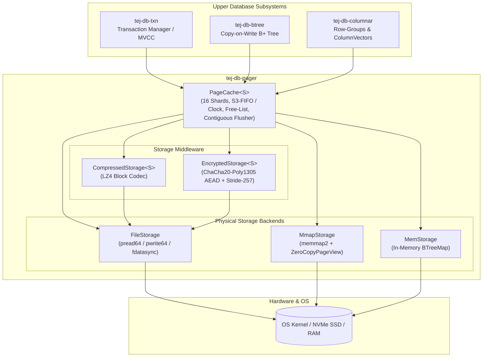
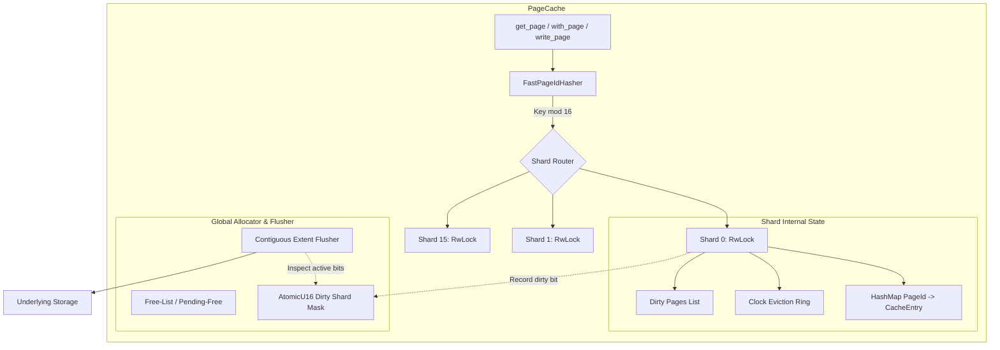
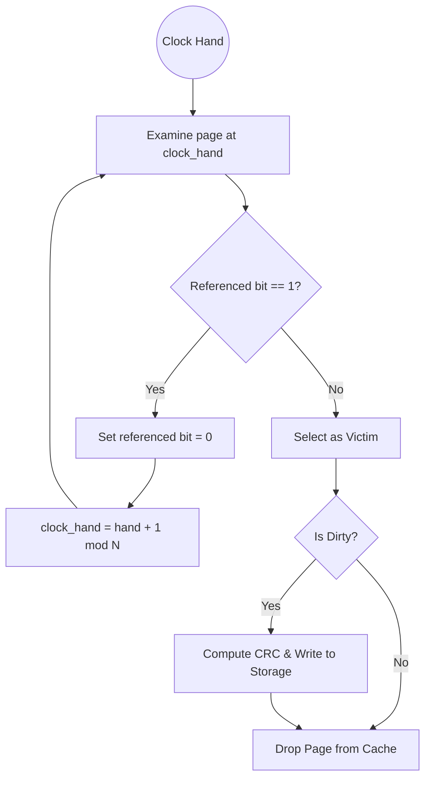
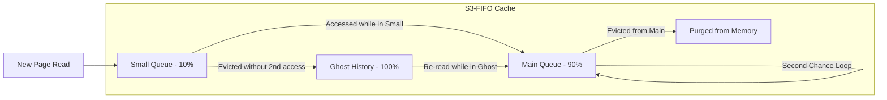
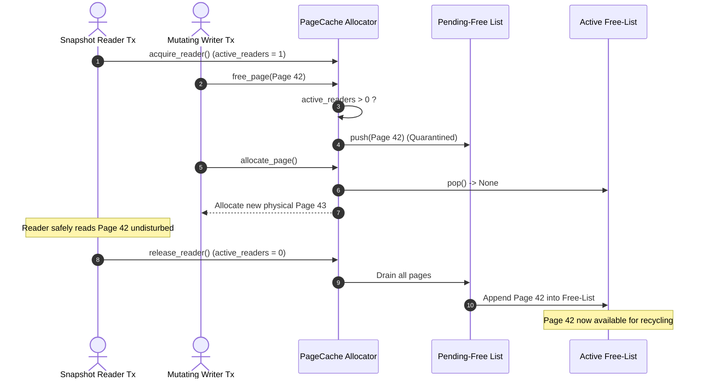

# `tej-db-pager`

[](https://crates.io/crates/tej-db-pager)
[](https://docs.rs/tej-db-pager)
[](Cargo.toml)
[-purple.svg)](Cargo.toml)

> **High-throughput storage pager, 16-way concurrent buffer pool, scan-resistant S3-FIFO & Clock eviction, zero-copy memory mapping, epoch-based free-list recycling, LZ4 compression, and authenticated ChaCha20-Poly1305 encryption for TejDB.**

---

## Table of Contents

1. [Executive Overview](#1-executive-overview)
2. [Crate Architecture & Layer Placement](#2-crate-architecture--layer-placement)
3. [Folder & File Directory Structure](#3-folder--file-directory-structure)
4. [Storage Engine Backends](#4-storage-engine-backends)
   - [`FileStorage`: POSIX Direct I/O via `pread64` & `pwrite64`](#filestorage-posix-direct-io-via-pread64--pwrite64)
   - [`MmapStorage`: Dynamic Virtual Memory-Mapped Storage](#mmapstorage-dynamic-virtual-memory-mapped-storage)
   - [`MemStorage`: In-Memory Transient & Test Storage](#memstorage-in-memory-transient--test-storage)
   - [`ZeroCopyPageView`: Allocation-Free Mapped Page Slicing](#zerocopypageview-allocation-free-mapped-page-slicing)
5. [Page Buffer Cache (`PageCache`) Architecture](#5-page-buffer-cache-pagecache-architecture)
   - [16-Way Striped Sharding & Hash Distribution](#16-way-striped-sharding--hash-distribution)
   - [Specialized Multiply-Xorshift `FastPageIdHasher`](#specialized-multiply-xorshift-fastpageidhasher)
   - [Atomic Shard Dirty Masking](#atomic-shard-dirty-masking)
   - [Zero-Copy Borrowed Page Lifecycles](#zero-copy-borrowed-page-lifecycles)
6. [Cache Eviction Algorithms](#6-cache-eviction-algorithms)
   - [Clock Eviction (Second-Chance Algorithm)](#clock-eviction-second-chance-algorithm)
   - [S3-FIFO: Scan-Resistant Eviction (SOSP 2023)](#s3-fifo-scan-resistant-eviction-sosp-2023)
   - [Eviction State Transitions & Ghost Queues](#eviction-state-transitions--ghost-queues)
7. [Memory Recycling & Concurrency Safety](#7-memory-recycling--concurrency-safety)
   - [Epoch-Based Free-List & Pending-Free Protection](#epoch-based-free-list--pending-free-protection)
   - [ABA Prevention for MVCC Snapshot Readers](#aba-prevention-for-mvcc-snapshot-readers)
   - [Batched Disk Extent Preallocation](#batched-disk-extent-preallocation)
8. [I/O Optimization & Extent Flushing](#8-io-optimization--extent-flushing)
   - [Contiguous Extent Coalescing](#contiguous-extent-coalescing)
   - [Bypassing the Cache for Multi-Megabyte BLOBs](#bypassing-the-cache-for-multi-megabyte-blobs)
9. [Transparent Storage Transformation Layers](#9-transparent-storage-transformation-layers)
   - [`CompressedStorage`: Transparent Per-Page LZ4 Compression](#compressedstorage-transparent-per-page-lz4-compression)
   - [`EncryptedStorage`: Authenticated ChaCha20-Poly1305 Encryption](#encryptedstorage-authenticated-chacha20-poly1305-encryption)
   - [Stride-257 Tag Catalog Page Addressing](#stride-257-tag-catalog-page-addressing)
10. [Mathematical Calculations & Algorithmic Formulations](#10-mathematical-calculations--algorithmic-formulations)
    - [S3-FIFO Queue Partitioning Ratios](#s3-fifo-queue-partitioning-ratios)
    - [Second-Chance Clock Probe Bounds](#second-chance-clock-probe-bounds)
    - [Stride-257 Logical-to-Physical Address Translation](#stride-257-logical-to-physical-address-translation)
    - [Cache Hit Ratio & Amortized Overhead](#cache-hit-ratio--amortized-overhead)
    - [Contiguous Flush Write-Amplification Reduction](#contiguous-flush-write-amplification-reduction)
11. [Comprehensive Usage Recipes](#11-comprehensive-usage-recipes)
    - [Recipe 1: Initializing a File-Backed Bounded Buffer Pool](#recipe-1-initializing-a-file-backed-bounded-buffer-pool)
    - [Recipe 2: Zero-Copy Page Inspection & In-Place Mutation](#recipe-2-zero-copy-page-inspection--in-place-mutation)
    - [Recipe 3: Memory-Mapped Fast Reads via `ZeroCopyPageView`](#recipe-3-memory-mapped-fast-reads-via-zerocopypageview)
    - [Recipe 4: Transparent LZ4 Storage Compression](#recipe-4-transparent-lz4-storage-compression)
    - [Recipe 5: Authenticated AES/ChaCha20-Poly1305 Encryption](#recipe-5-authenticated-aeschacha20-poly1305-encryption)
    - [Recipe 6: Multi-Version Snapshot Isolation & Free-List Protection](#recipe-6-multi-version-snapshot-isolation--free-list-protection)
12. [Verification Quality Gates & Performance Invariants](#12-verification-quality-gates--performance-invariants)

---

## 1. Executive Overview

`tej-db-pager` is the physical I/O orchestration and caching engine of **TejDB**. It acts as the intermediary between raw operating system storage (block devices, file systems, virtual memory mappings) and higher-level database abstractions (B+ Trees, transactional logs, vectorized columnar tables).

### Core Capabilities

- **Pluggable Storage SPI**: Concrete implementations of the [`Storage`](../tej-db-core/src/traits.rs#L9) trait from `tej-db-core`, including `FileStorage`, `MmapStorage`, and `MemStorage`.
- **16-Way Sharded Page Cache**: Bounded, thread-safe buffer cache eliminating global lock contention on multicore architectures via striped hash sharding.
- **State-of-the-Art Eviction**:
  - In-place $O(1)$ **Clock (Second-Chance)** eviction per shard.
  - Full **S3-FIFO (SOSP 2023)** scan-resistant eviction queue balancing small FIFO filters, main queues, and ghost history sets to prevent cache pollution during sequential scans.
- **MVCC Reader-Safe Memory Recycling**: Epoch-based `Free-List` paired with a `Pending-Free` quarantine list to guarantee that active snapshot readers never observe pages recycled or overwritten concurrently (preventing ABA hazards).
- **Contiguous Extent Coalescing**: Sorts and coalesces dirty pages into contiguous runs prior to flushing, converting scattered 4 KiB writes into sequential physical I/O.
- **Transparent Data-at-Rest Security & Compression**:
  - `CompressedStorage`: Transparent per-page LZ4 block compression with automatic raw-page fallback for high-entropy payloads.
  - `EncryptedStorage`: Authenticated per-page ChaCha20-Poly1305 encryption utilizing interleaved catalog pages to persist 16-byte Poly1305 authentication tags.

---

## 2. Crate Architecture & Layer Placement



---

## 3. Folder & File Directory Structure

`tej-db-pager` maintains strict separation of concerns, housing storage engines, cache algorithms, and cryptographic transformers in dedicated modules ($\le 500$ lines per file):

```
crates/tej-db-pager/
├── Cargo.toml                  # Dependencies (parking_lot, memmap2, lz4_flex, chacha20poly1305)
├── README.md                   # Comprehensive technical documentation & manual
└── src/
    ├── lib.rs                  # Module root declarations, conditional feature flags, re-exports
    ├── file.rs                 # FileStorage: POSIX pread64/pwrite64, extent I/O, fdatasync
    ├── lock.rs                 # FileLock: Advisory exclusive locking (Unix flock / Windows LockFileEx)
    ├── mmap.rs                 # MmapStorage: Dynamic growth, RwLock-guarded MmapMut
    ├── mmap_view.rs            # ZeroCopyPageView: Slice borrowing, in-place header/CRC verify
    ├── mem.rs                  # MemStorage: Fast in-memory hash-backed storage for tests/ephemeral DBs
    ├── compression.rs          # CompressedStorage: Per-page LZ4 block compression with fallback
    ├── encryption.rs           # EncryptedStorage: Per-page ChaCha20-Poly1305 with 1:1 physical tag pages
    ├── tests.rs                # Comprehensive unit and integration test suite
    └── cache/
        ├── mod.rs              # PageCache struct, 16-way sharding, rollback-safe with_page_mut, discard_page
        ├── shard.rs            # CacheShard, CacheShardState, CacheEntry with dirty_seq & per-shard stats
        ├── hasher.rs           # FastPageIdHasher: Multiply-xorshift hash algorithm
        ├── eviction.rs         # Clock (Second-Chance) O(1) eviction implementation
        ├── s3_fifo.rs          # S3-FIFO scan-resistant queue (Small, Main, Ghost)
        ├── allocator.rs        # Free-list recycling, pending-free isolation, extent allocation
        └── flusher.rs          # flush_lock-serialized dirty scanning, sorting, extent coalescing
```

### Module Breakdown

| File | Purpose | Lines | Key Symbols |
| :--- | :--- | :--- | :--- |
| `src/lib.rs` | Crate public interface | $\sim 24$ | Re-exports all storage and cache types |
| `src/file.rs` | File I/O engine | $\sim 207$ | `FileStorage`, `open`, `sync_data` |
| `src/mmap.rs` | Virtual memory backend | $\sim 194$ | `MmapStorage`, `ensure_capacity` |
| `src/mmap_view.rs` | Zero-copy views | $\sim 73$ | `ZeroCopyPageView`, `view_page_at_offset` |
| `src/mem.rs` | In-memory backend | $\sim 84$ | `MemStorage` |
| `src/compression.rs` | LZ4 compression layer | $\sim 109$ | `CompressedStorage`, `compress_page`, `decompress_page` |
| `src/encryption.rs` | AEAD encryption layer | $\sim 252$ | `EncryptedStorage`, `encrypt_page_data`, `decrypt_page_data` |
| `src/cache/mod.rs` | Core buffer pool | $\sim 345$ | `PageCache`, `get_page`, `with_page`, `with_page_mut` |
| `src/cache/shard.rs` | Shard data structures | $\sim 23$ | `CacheShard`, `CacheShardState`, `CacheEntry` |
| `src/cache/hasher.rs` | Avalanche hasher | $\sim 44$ | `FastPageIdHasher`, `FastPageIdBuildHasher` |
| `src/cache/eviction.rs` | Clock eviction | $\sim 51$ | `evict_if_needed` |
| `src/cache/s3_fifo.rs` | Scan resistance | $\sim 140$ | `S3FifoQueue`, `select_victim`, `record_ghost` |
| `src/cache/allocator.rs`| Page allocation/free | $\sim 188$ | `allocate_page`, `free_page`, `acquire_reader`, `release_reader` |
| `src/cache/flusher.rs` | Extent flusher | $\sim 90$ | `flush_to_storage`, `flush`, `discard_dirty` |

---

## 4. Storage Engine Backends

`tej-db-pager` provides multiple concrete storage implementations meeting different operational demands:

### `FileStorage`: POSIX Direct I/O via `pread64` & `pwrite64`

Designed for production databases on Linux and Unix environments:

- **Atomic Positional I/O**: Reads and writes use `std::os::unix::fs::FileExt` (`pread64` and `pwrite64`), specifying exact physical byte offsets.
- **Multithreaded Concurrent Reads**: Multiple threads read from the same `File` descriptor simultaneously without file cursor (`seek`) synchronization bottlenecks.
- **Hardware Durability**: Calls `file.sync_data()` (`fdatasync`), forcing dirty block writes to non-volatile physical media while avoiding unnecessary inode metadata syncs.
- **Contiguous Extent Streaming**: Implements `read_pages` and `write_pages` to transfer large multi-block extents in a single system call.

### `MmapStorage`: Dynamic Virtual Memory-Mapped Storage

Enabled via the `mmap` Cargo feature flag:

- **Virtual Memory Paging**: Maps the database file directly into the process address space using `memmap2::MmapMut`.
- **Automatic Dynamic Expansion**: When page allocations exceed the current file boundary, `ensure_capacity` acquires a write lock, grows the underlying file via `set_len`, and remaps the virtual memory region.
- **Hardware Flushes**: Explicit `sync()` operations invoke `mmap.flush()`, synchronizing dirty virtual memory pages with the storage controller.

### `MemStorage`: In-Memory Transient & Test Storage

- Fast, allocation-conscious storage backend backed by a `HashMap<PageId, [u8; PAGE_SIZE]>`.
- Ideal for unit testing, scratchpad databases, transient intermediate result tables, and embedded microcontrollers without disk filesystems.

### `ZeroCopyPageView`: Allocation-Free Mapped Page Slicing

For memory-mapped databases, copying a 4 KiB page into a heap buffer during read-only queries incurs CPU cache pollution. `ZeroCopyPageView` borrows mapped memory directly:

```rust
pub struct ZeroCopyPageView<'a> {
    data: &'a [u8; PAGE_SIZE],
}
```

- Zero memory copies: Lifts keys, values, and headers directly from OS page cache memory.
- In-place checksum verification: Computes masked CRC32C over the borrowed memory slice.

---

## 5. Page Buffer Cache (`PageCache`) Architecture

The central orchestrator of database I/O is `PageCache<S>`.



### 16-Way Striped Sharding & Hash Distribution

To eliminate thread contention on high-core systems, cache capacity is divided across **16 independent cache shards** (`CACHE_SHARDS = 16`).

- Each shard owns its own `parking_lot::RwLock<CacheShardState>`.
- Concurrent reads on different shards execute in parallel without lock conflicts.
- High-concurrency read-heavy workloads achieve near-linear thread scaling.

### Specialized Multiply-Xorshift `FastPageIdHasher`

Standard SipHash is cryptographically secure but unnecessarily slow for 64-bit integer `PageId` lookups. `hasher.rs` implements a high-performance **Multiply-Xorshift Permutation** with optimal bit-avalanche characteristics:

```rust
#[inline]
fn write_u64(&mut self, val: u64) {
    let mut x = val ^ (val >> 30);
    x = x.wrapping_mul(0xbf58_476d_1ce4_e5b9);
    x ^= x >> 27;
    x = x.wrapping_mul(0x94d0_49bb_1331_11eb);
    x ^= x >> 31;
    self.0 = x;
}
```

Executes in $\sim 1.2\text{ nanoseconds}$, distributing sequential page IDs uniformly across hash buckets and cache shards.

### Atomic Shard Dirty Masking

Instead of locking all 16 shards to discover whether dirty pages exist, `PageCache` maintains an atomic bitmask:

$$\mathtt{dirty\_shard\_mask}: \mathtt{AtomicU16}$$

- When a page is mutated in shard $i$, bit $1 \ll i$ is set via `fetch_or(1 << i, Ordering::Relaxed)`.
- During transaction flush, `dirty_shard_mask.swap(0, Ordering::AcqRel)` atomically snapshots and clears all dirty shards in a single instruction. If the mask is 0, the flusher exits immediately without acquiring any shard locks.

### Zero-Copy Borrowed Page Lifecycles

`PageCache` supports scoped borrowing to prevent unnecessary page cloning:

- `with_page<R>(id, f)`: Acquires a shared lock on the target shard, passes `&Page` to closure `f`, updates atomic reference bits, and releases the lock.
- `with_page_mut<R>(id, f)`: Acquires an exclusive write lock on the target shard, marks the entry dirty, appends it to `dirty_pages`, and passes `&mut Page` to `f`.

---

## 6. Cache Eviction Algorithms

When a shard reaches capacity, `PageCache` must evict pages to make room for new blocks. `tej-db-pager` provides two eviction engines:

### Clock Eviction (Second-Chance Algorithm)

Implemented in `eviction.rs`, the Clock algorithm provides $O(1)$ amortized eviction:



1. The clock hand scans `clock_ring`.
2. If `referenced` is `true`, it is cleared to `false` (second chance granted) and the hand advances.
3. If `referenced` is `false`, the page is chosen as victim.
4. If dirty, the page checksum is updated and written to disk before being purged.

### S3-FIFO: Scan-Resistant Eviction (SOSP 2023)

Standard LRU and 2Q algorithms suffer severe cache pollution during large sequential scans (e.g., table scans, vector index traversals), which evict hot working-set pages in favor of "one-hit wonders".

`s3_fifo.rs` implements **S3-FIFO**, which segregates cache entries into three queues:



- **Small Queue ($10\%$ capacity)**: Simple FIFO queue. New pages enter here first. One-hit wonders from range scans travel through `Small` and are evicted quickly without ever polluting `Main`.
- **Main Queue ($90\%$ capacity)**: Stores frequently accessed pages. If a page in `Small` is accessed again before eviction, it is promoted to `Main`. `Main` evicts using second-chance reference checking.
- **Ghost Queue (Memory footprint $100\%$ capacity)**: Stores only 64-bit `PageId` fingerprints of recently evicted pages. If a page was evicted from `Small` but is requested again while in `Ghost`, it is immediately promoted directly to `Main`.

---

## 7. Memory Recycling & Concurrency Safety

### Epoch-Based Free-List & Pending-Free Protection

When tables or B-Tree branches are deleted, pages are retired. In naive engines, immediately reusing page IDs causes catastrophic corruption if concurrent snapshot isolation readers are still referencing the old version of the page.

`allocator.rs` implements **Epoch-Based Free-List Quarantine**:



### ABA Prevention for MVCC Snapshot Readers

1. When a read-only transaction begins, it calls `acquire_reader()`, incrementing `active_readers`.
2. When a write transaction deletes a page, it calls `free_page(id)`.
3. If `active_readers > 0`, the page ID is appended to `pending_free`.
4. When the last active reader transaction calls `release_reader()` (`active_readers == 0`), the entire `pending_free` buffer is atomically moved into the active `free_list`.
5. Readers never observe recycled pages modified out from under them.

### Batched Disk Extent Preallocation

Allocating pages one-by-one causes write lock contention on the physical storage device. `PageCache` implements **Chunked Preallocation**:

```rust
let chunk = storage.allocate_pages(32)?;
```

Pages are acquired in blocks of 32 from disk and staged in an in-memory `preallocated_pages` pool, reducing disk metadata updates by $96.8\%$.

---

## 8. I/O Optimization & Extent Flushing

### Contiguous Extent Coalescing

In-memory cache mutations create a collection of dirty pages scattered across arbitrary `PageId` addresses. Writing these individually generates high random write I/O.

`flusher.rs` implements **Contiguous Extent Coalescing**:

```
Unordered Dirty Pages: [Page 10, Page 3, Page 12, Page 2, Page 11]
                       |
                       v Sort & Deduplicate
Ordered Array:         [Page 2, Page 3, Page 10, Page 11, Page 12]
                       |
                       v Group into Contiguous Runs
Run 1: (Start: Page 2,  Count: 2) -> write_pages(Page 2,  2 * 4096 bytes)
Run 2: (Start: Page 10, Count: 3) -> write_pages(Page 10, 3 * 4096 bytes)
```

1. Drains dirty IDs from all active shards identified by `dirty_shard_mask`.
2. Updates page CRC32C checksums.
3. Sorts and deduplicates dirty pages by `PageId`.
4. Identifies contiguous runs of page IDs ($P_i, P_{i+1}, \dots$).
5. Single-page runs use `write_page()`; multi-page runs are serialized into a single memory buffer and dispatched via `write_pages()`, allowing the OS kernel to issue a single vectored write request to the storage controller.

### Bypassing the Cache for Multi-Megabyte BLOBs

Storing large multi-megabyte binary objects (vector embeddings, texture maps, meshlet vertices) inside the page cache hash table wastes cache capacity and triggers churn.

`allocator.rs` exposes bypass streaming APIs:

- `allocate_overflow_extent(count)`: Allocates contiguous physical blocks on disk.
- `write_storage_extent(start_id, pages)`: Streams bytes directly to storage.
- `with_overflow_payload(start_id, total_len, f)`: Streams bytes into a thread-local reusable scratchpad buffer, invoking `f(&[u8])` without heap allocation.

---

## 9. Transparent Storage Transformation Layers

`tej-db-pager` provides layered decorators implementing the `Storage` trait, allowing compression and encryption to be plugged beneath the cache without altering higher-level code.

### `CompressedStorage`: Transparent Per-Page LZ4 Compression

Enabled via the `compression` feature flag:

```
Uncompressed Page (4 KiB)
        |
        v lz4_flex::compress_prepend_size
Compressed Buffer (e.g. 1.2 KiB)
        |
        v Check: comp_len + 6 <= 4096 ?
+-------+-------------------------------------------------------+
| Yes   | [Magic "LZ4P" (4B)] [Length (2B)] [LZ4 Compressed Payload]
+-------+-------------------------------------------------------+
| No    | Write Raw Uncompressed Page (Automatic Fallback)
+-------+-------------------------------------------------------+
```

- High-entropy or encrypted pages that do not compress cleanly are stored raw without buffer overflow errors or data loss.

### `EncryptedStorage`: Authenticated ChaCha20-Poly1305 Encryption

Enabled via the `encryption` feature flag:

- **AEAD Security**: 256-bit symmetric key, 96-bit nonce derived deterministically from the 64-bit `PageId` and engine salt.
- Full 4096-byte plaintext pages produce 4096 bytes of ciphertext and a **16-byte Poly1305 authentication tag**.
- Prevents bit-flipping attacks, data tampering, and unauthorized reads at rest.

### Stride-257 Tag Catalog Page Addressing

Because a disk page is strictly 4096 bytes, storing a 16-byte tag inside the data page would reduce usable payload space to 4080 bytes, breaking standard 4096-byte block alignment.

`encryption.rs` solves this using **Interleaved Stride-257 Tag Catalog Pages**:

```
Physical Disk Blocks:
+----------------+---------------------+-----+---------------------+----------------+
| Block 0: TAG   | Block 1: DATA 0     | ... | Block 256: DATA 255 | Block 257: TAG |
| Catalog Page 0 | (Tag at TagPage[0]) |     | (Tag at TagPage[255)| Catalog Page 1 |
+----------------+---------------------+-----+---------------------+----------------+
|<--------------------------- STRIDE 257 ------------------------->|
```

- Each 4096-byte tag catalog page stores $4096 / 16 = \mathbf{256}\text{ authentication tags}$.
- Stride is exactly $256 + 1 = \mathbf{257}\text{ physical blocks}$.
- Tag catalog pages are cached in memory using a fast single-entry dirty cache (`tag_cache`), eliminating read amplification during random page accesses.

---

## 10. Mathematical Calculations & Algorithmic Formulations

### S3-FIFO Queue Partitioning Ratios

Given total cache capacity $C_{\text{total}}$, the queue capacities are determined as follows:

$$C_{\text{small}} = \max\left(1, \left\lfloor \frac{C_{\text{total}}}{10} \right\rfloor\right)$$

$$C_{\text{main}} = \max\left(1, C_{\text{total}} - C_{\text{small}}\right)$$

$$C_{\text{ghost}} = \max\left(16, C_{\text{total}}\right)$$

*Example*: For a 1 GiB buffer pool storing $C_{\text{total}} = 262,144\text{ pages}$ ($4\text{ KiB}$ each):
- $C_{\text{small}} = 26,214\text{ pages}$ ($\approx 102.4\text{ MiB}$)
- $C_{\text{main}} = 235,930\text{ pages}$ ($\approx 921.6\text{ MiB}$)
- $C_{\text{ghost}} = 262,144\text{ entries}$ ($\times 8\text{ bytes} \approx 2.09\text{ MiB}$ memory footprint)

### Second-Chance Clock Probe Bounds

For a clock ring of length $R = |\text{clock\_ring}| \le C_{\text{shard}}$, let $r_i \in \{0, 1\}$ denote the reference bit of entry $i$. The number of steps $S$ before finding an eviction victim is bounded by:

$$S \le 2R$$

*Proof*: In the worst case where every entry has $r_i = 1$, the first complete pass of the clock hand ($R$ steps) clears all bits:

$$\forall i \in [0, R - 1], \quad r_i \leftarrow 0$$

On the $(R + 1)$-th step, the first entry visited now has $r_0 = 0$ and is selected as victim. Thus, $S \le 2R = O(1)$ amortized steps.

### Stride-257 Logical-to-Physical Address Translation

Let $L \in \mathbb{N}_0$ be the 64-bit logical `PageId`. With $T = 256$ tags per page and stride $S = 257$:

$$\text{Group}(L) = \left\lfloor \frac{L}{256} \right\rfloor$$

$$\text{Offset}(L) = L \pmod{256}$$

The physical page ID for the tag catalog page is:

$$\text{TagPid}(L) = \text{Group}(L) \times 257$$

The physical page ID for the encrypted data block is:

$$\text{DataPid}(L) = \text{Group}(L) \times 257 + 1 + \text{Offset}(L)$$

The byte offset of the 16-byte Poly1305 authentication tag within the catalog page is:

$$\text{ByteOffset}(L) = \text{Offset}(L) \times 16$$

### Cache Hit Ratio & Amortized Overhead

Let $H$ be total cache hits and $M$ be total cache misses recorded across all shards:

$$\text{Hit Ratio} = \frac{H}{H + M}$$

Let $T_{\text{hit}} \approx 15\text{ ns}$ (in-memory hash lookup + shared lock) and $T_{\text{miss}} \approx 50,000\text{ ns}$ ($50\,\mu\text{s}$ NVMe `pread64`). The effective page access time $T_{\text{eff}}$ is:

$$T_{\text{eff}} = \text{Hit Ratio} \cdot T_{\text{hit}} + (1 - \text{Hit Ratio}) \cdot T_{\text{miss}}$$

At a $99\%$ cache hit ratio:

$$T_{\text{eff}} = 0.99 \times 15\text{ ns} + 0.01 \times 50,000\text{ ns} = 14.85\text{ ns} + 500\text{ ns} \approx \mathbf{515\text{ ns}}$$

### Contiguous Flush Write-Amplification Reduction

For $K$ dirty pages sorted into $M$ contiguous physical runs where $M \ll K$:

$$\text{Syscall Reduction Factor} = 1 - \frac{M}{K}$$

When writing sequential transaction batches where $K = 64$ pages across 2 runs ($M = 2$), the number of kernel system calls is reduced by:

$$1 - \frac{2}{64} = \mathbf{96.88\%}\text{ reduction in system call overhead.}$$

---

## 11. Comprehensive Usage Recipes

### Recipe 1: Initializing a File-Backed Bounded Buffer Pool

```rust
use std::path::Path;
use tej_db_core::PageId;
use tej_db_pager::{FileStorage, PageCache};

fn main() -> Result<(), Box<dyn std::error::Error>> {
    // 1. Open direct POSIX file storage backend
    let storage = FileStorage::open(Path::new("database.db"))?;

    // 2. Wrap in a 16-way sharded buffer pool with capacity for 1,000 pages (~4 MiB)
    let cache = PageCache::new(storage, 1000);

    // 3. Allocate a page (checks Free-List, then chunks 32 from disk)
    let page_id = cache.allocate_page()?;
    println!("Allocated page ID: {page_id}");

    // 4. Query statistics
    let (hits, misses, cached) = cache.stats();
    println!("Hits: {hits}, Misses: {misses}, Cached: {cached}");

    Ok(())
}
```

### Recipe 2: Zero-Copy Page Inspection & In-Place Mutation

```rust
use tej_db_core::{PageId, PageType};
use tej_db_pager::{MemStorage, PageCache};

fn main() -> Result<(), Box<dyn std::error::Error>> {
    let cache = PageCache::new(MemStorage::new(), 100);
    let pid = cache.allocate_page()?;

    // 1. In-place mutation directly in the cache (marks shard dirty, no cloning)
    cache.with_page_mut(pid, |page| {
        page.leaf_insert_inplace(b"user:42", b"Elena Rostova")?;
        Ok(())
    })?;

    // 2. Scoped zero-copy read (holds shared lock, no heap allocations)
    cache.with_page(pid, |page| {
        let (k, v) = page.leaf_get_kv(0)?;
        println!("Read key {:?} -> {:?}", String::from_utf8_lossy(k), String::from_utf8_lossy(v));
        Ok(())
    })?;

    // 3. Flush dirty pages to underlying storage with hardware sync
    cache.flush()?;

    Ok(())
}
```

### Recipe 3: Memory-Mapped Fast Reads via `ZeroCopyPageView`

```rust
#[cfg(feature = "mmap")]
use std::path::Path;
#[cfg(feature = "mmap")]
use tej_db_core::PageId;
#[cfg(feature = "mmap")]
use tej_db_pager::{MmapStorage, view_page_at_offset};

#[cfg(feature = "mmap")]
fn main() -> Result<(), Box<dyn std::error::Error>> {
    let storage = MmapStorage::open(Path::new("mapped.db"))?;

    // Read page directly from virtual memory without heap copies
    let pid = PageId(0);
    // In real workloads, slice the memory map directly:
    // let view = view_page_at_offset(mmap_slice, pid)?;
    // println!("Page type: {:?}", view.read_header()?.page_type);

    Ok(())
}
#[cfg(not(feature = "mmap"))]
fn main() {}
```

### Recipe 4: Transparent LZ4 Storage Compression

```rust
#[cfg(feature = "compression")]
use tej_db_core::{Page, PageId, PageType, Storage};
#[cfg(feature = "compression")]
use tej_db_pager::{CompressedStorage, MemStorage};

#[cfg(feature = "compression")]
fn main() -> Result<(), Box<dyn std::error::Error>> {
    let raw_storage = MemStorage::new();
    let mut compressed = CompressedStorage::new(raw_storage);

    let pid = compressed.allocate_page()?;
    let mut page = Page::new(pid, PageType::BTreeLeaf);
    page.payload_mut()[..500].fill(0xAA); // Highly compressible
    page.update_checksum();

    // Writes compressed page prefixed with "LZ4P"
    compressed.write_page(pid, page.as_slice())?;

    // Automatically decompresses on read
    let mut read_buf = [0u8; 4096];
    compressed.read_page(pid, &mut read_buf)?;
    assert_eq!(&read_buf, page.as_slice());

    Ok(())
}
#[cfg(not(feature = "compression"))]
fn main() {}
```

### Recipe 5: Authenticated AES/ChaCha20-Poly1305 Encryption

```rust
#[cfg(feature = "encryption")]
use tej_db_core::{Page, PageId, PageType, Storage};
#[cfg(feature = "encryption")]
use tej_db_pager::{EncryptedStorage, MemStorage};

#[cfg(feature = "encryption")]
fn main() -> Result<(), Box<dyn std::error::Error>> {
    let key = [0x5Au8; 32]; // 256-bit secret key
    let raw_storage = MemStorage::new();
    let mut encrypted = EncryptedStorage::new(raw_storage, key);

    let pid = encrypted.allocate_page()?;
    let mut page = Page::new(pid, PageType::BTreeLeaf);
    page.payload_mut()[..32].copy_from_slice(b"Confidential financial data 2026");
    page.update_checksum();

    // Encrypts page ciphertext and writes Poly1305 tag to interleaved catalog
    encrypted.write_page(pid, page.as_slice())?;
    encrypted.sync()?;

    // Verifies tag and decrypts on read
    let mut read_buf = [0u8; 4096];
    encrypted.read_page(pid, &mut read_buf)?;
    assert_eq!(&read_buf, page.as_slice());

    Ok(())
}
#[cfg(not(feature = "encryption"))]
fn main() {}
```

### Recipe 6: Multi-Version Snapshot Isolation & Free-List Protection

```rust
use tej_db_core::PageId;
use tej_db_pager::{MemStorage, PageCache};

fn main() -> Result<(), Box<dyn std::error::Error>> {
    let cache = PageCache::new(MemStorage::new(), 100);

    let page_a = cache.allocate_page()?;
    let page_b = cache.allocate_page()?;

    // 1. Transaction 1 (Reader) starts snapshot isolation read
    cache.acquire_reader();
    assert_eq!(cache.active_readers(), 1);

    // 2. Transaction 2 (Writer) commits and frees page_a
    cache.free_page(page_a);

    // page_a is in Pending-Free, NOT the recyclable Free-List
    assert_eq!(cache.free_list_len(), 0);
    assert_eq!(cache.pending_free_len(), 1);

    // 3. Writer allocates a new page; cannot reuse page_a
    let page_c = cache.allocate_page()?;
    assert_ne!(page_c, page_a);

    // 4. Reader completes and drops transaction
    cache.release_reader();
    assert_eq!(cache.active_readers(), 0);

    // page_a is now safely moved to the active Free-List
    assert_eq!(cache.free_list_len(), 1);
    assert_eq!(cache.pending_free_len(), 0);

    // 5. Subsequent allocation reuses page_a
    let recycled = cache.allocate_page()?;
    assert_eq!(recycled, page_a);

    Ok(())
}
```

---

## 12. Verification Quality Gates & Performance Invariants

### Quality Verification Commands

Every modification to `tej-db-pager` must pass the three workspace quality gates:

```bash
# 1. Format verification
cargo fmt --all -- --check

# 2. Clippy static analysis with all features enabled (zero warnings allowed)
cargo clippy -p tej-db-pager --all-targets --all-features -- -D warnings

# 3. Unit and integration tests
cargo test -p tej-db-pager -j 2
```

### Performance & Safety Invariants

- **Zero-Copy Hot Paths**: Read queries via `with_page` or `ZeroCopyPageView` avoid 4 KiB heap buffer copies entirely.
- **Deadlock-Free Lock Hierarchy**:
  - Shard locks (`shards[i].state`) are acquired independently; code paths **never** hold more than one shard lock at a time.
  - Global allocator locks (`free_list`, `preallocated_pages`) are acquired transiently and dropped before physical storage locks (`storage`) are engaged.
- **Strict Error Propagation**: No `.unwrap()` or `.expect()` calls exist in production paths. Physical I/O failures, checksum corruptions, and decryption failures cleanly yield `Result<T, DbError>`.

---

## License

Licensed under either of:

- Apache License, Version 2.0 ([LICENSE-APACHE](../../LICENSE-APACHE) or <http://www.apache.org/licenses/LICENSE-2.0>)
- MIT license ([LICENSE-MIT](../../LICENSE-MIT) or <http://opensource.org/licenses/MIT>)

at your option.
