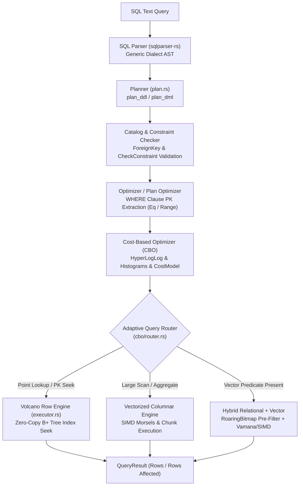
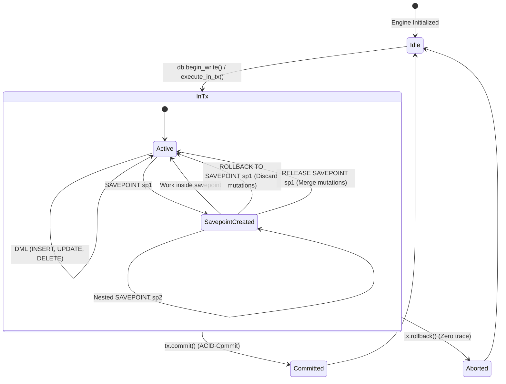
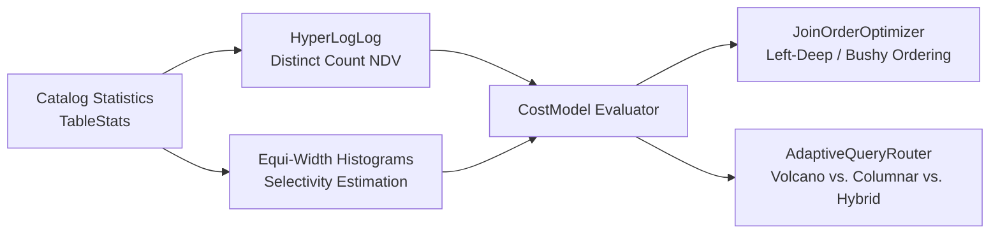
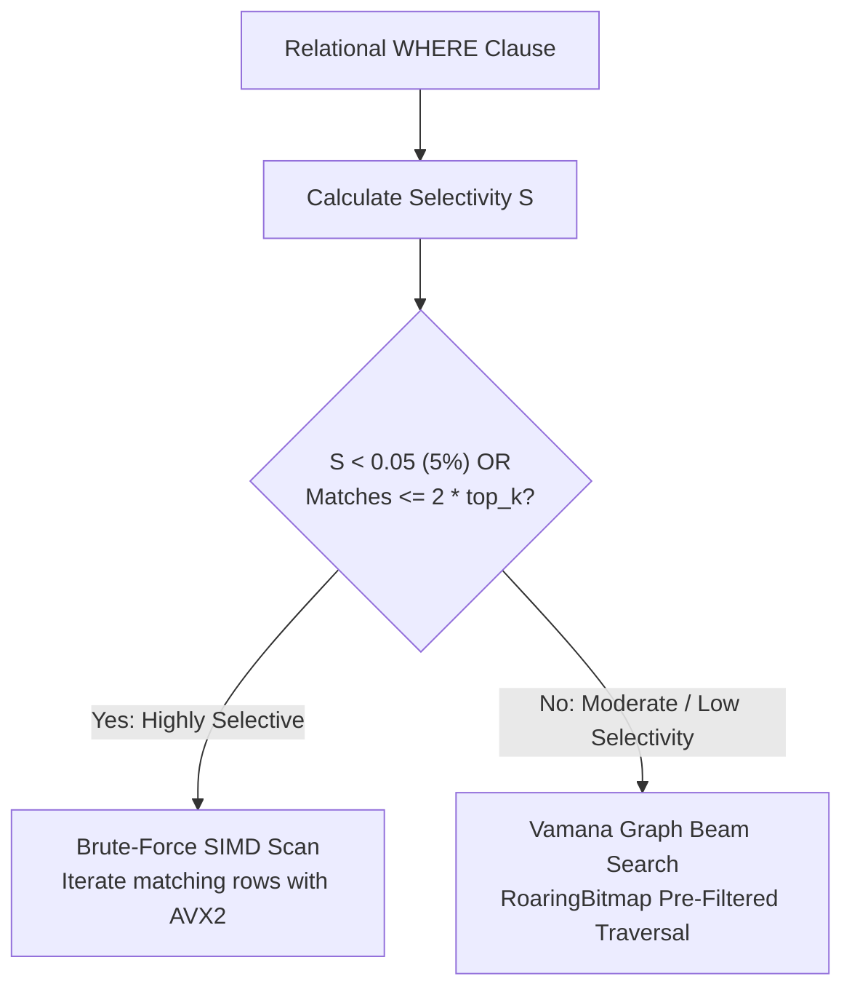

# `tej-db-sql`: ANSI/SQLite-Compatible SQL Engine, CBO & Relational Execution

[](https://crates.io/crates/tej-db-sql)
[](https://docs.rs/tej-db-sql)
[](LICENSE)
[]()

`tej-db-sql` delivers a full-featured, transactional SQL execution engine for the `tej-db` ecosystem. Built directly on top of the modular ACID storage engine (`tej-db`) and integrating with the vectorized analytics engine (`tej-db-vectorized`), the columnar format (`tej-db-columnar`), and the vector index (`tej-db-vector`), `tej-db-sql` provides SQLite-parity convenience with enterprise DBMS capabilities.

The crate combines standards-compliant SQL parsing (`sqlparser`), schema catalog management, table integrity constraints (Foreign Keys and CHECK constraints), Cost-Based Optimization (CBO) driven by HyperLogLog and equi-width histograms, adaptive query routing, high-performance window functions, Okapi BM25 full-text lexical search, and hybrid dense vector similarity execution.

---

## Table of Contents

1. [Executive Overview](#executive-overview)
2. [Folder & Source File Structure](#folder--source-file-structure)
3. [Architecture & Execution Lifecycles](#architecture--execution-lifecycles)
   - [End-to-End SQL Pipeline](#end-to-end-sql-pipeline)
   - [Transaction & Savepoint Lifecycle](#transaction--savepoint-lifecycle)
   - [Binary Serialization & Key Layouts](#binary-serialization--key-layouts)
4. [Rich Type System & Serialization](#rich-type-system--serialization)
   - [Exact Fixed-Point Decimal](#exact-fixed-point-decimal)
   - [Temporal: Timestamp & Interval](#temporal-timestamp--interval)
   - [Universally Unique Identifiers (UUID)](#universally-unique-identifiers-uuid)
   - [Semi-Structured JSON / JSONB](#semi-structured-json--jsonb)
   - [Value Coercion & Zero-Allocation Keys](#value-coercion--zero-allocation-keys)
5. [Schema Catalog & Integrity Constraints](#schema-catalog--integrity-constraints)
   - [Catalog Persistence & Fast Lookup](#catalog-persistence--fast-lookup)
   - [Foreign Key Referential Integrity](#foreign-key-referential-integrity)
   - [CHECK Constraint Validation](#check-constraint-validation)
6. [Cost-Based Optimizer (CBO) & Routing](#cost-based-optimizer-cbo--routing)
   - [HyperLogLog Cardinality Estimation](#hyperloglog-cardinality-estimation)
   - [Equi-Width Histograms & Selectivity](#equi-width-histograms--selectivity)
   - [Physical Cost Model](#physical-cost-model)
   - [Join Order Optimization](#join-order-optimization)
   - [Adaptive Execution Router](#adaptive-execution-router)
7. [Window Functions](#window-functions)
   - [Supported Windows](#supported-windows)
   - [Integer Partition Fast Path](#integer-partition-fast-path)
8. [Full-Text Search (BM25) & Reciprocal Rank Fusion](#full-text-search-bm25--reciprocal-rank-fusion)
   - [Okapi BM25 Ranking](#okapi-bm25-ranking)
   - [Hybrid Reciprocal Rank Fusion (RRF)](#hybrid-reciprocal-rank-fusion-rrf)
9. [Hybrid Relational & Vector Search](#hybrid-relational--vector-search)
   - [RoaringBitmap Filter Pushdown](#roaringbitmap-filter-pushdown)
   - [Selectivity-Driven Strategy Selection](#selectivity-driven-strategy-selection)
10. [Prepared Statements & Execution Paths](#prepared-statements--execution-paths)
11. [Complete Production Recipes](#complete-production-recipes)
    - [Recipe 1: Schema Definition with Constraints](#recipe-1-schema-definition-with-constraints)
    - [Recipe 2: High-Throughput Prepared Statement Ingestion](#recipe-2-high-throughput-prepared-statement-ingestion)
    - [Recipe 3: Point Lookups & Primary Key Range Scans](#recipe-3-point-lookups--primary-key-range-scans)
    - [Recipe 4: Window Functions over Partitions](#recipe-4-window-functions-over-partitions)
    - [Recipe 5: Hybrid BM25 & Dense Vector RRF Search](#recipe-5-hybrid-bm25--dense-vector-rrf-search)
    - [Recipe 6: UPSERT with `RETURNING` Projections](#recipe-6-upsert-with-returning-projections)
    - [Recipe 7: Savepoints, Nested Transactions & Rollback](#recipe-7-savepoints-nested-transactions--rollback)
12. [Verification & Quality Gates](#verification--quality-gates)

---

## Executive Overview

`tej-db-sql` serves as the high-level declarative engine for the modular ACID database. While lower-level crates (`tej-db-core`, `tej-db-btree`, `tej-db-txn`, `tej-db-columnar`) handle raw pages, keys, concurrency control, and SIMD columnar chunks, `tej-db-sql` translates standard ANSI SQL queries into optimal physical execution strategies.

Key architectural highlights include:

- **Full SQLite & ANSI SQL Parity**: Supports standard DDL (`CREATE TABLE`), DML (`INSERT`, `UPDATE`, `DELETE`, `UPSERT`), DQL (`SELECT`, aggregations, filtering, ordering, projections), transaction control (`SAVEPOINT`, `RELEASE`, `ROLLBACK TO`), and introspection.
- **Advanced Domain Types**: Beyond standard primitives (integers, floats, strings, blobs, booleans), provides high-precision `Decimal` (128-bit fixed-point for banking), `Timestamp` (microsecond Unix epoch), `Interval` (months, days, microseconds), `Uuid` (16 bytes), `Json` (hierarchical path queries), and native `Vector(dim)` types.
- **Cost-Based Optimization (CBO)**: Employs 64-register HyperLogLog sketches for $O(1)$ memory distinct count estimation, 64-bucket equi-width histograms for numerical range selectivity, a parameterized hardware cost model, and greedy dynamic join ordering.
- **Adaptive Query Routing**: Automatically inspects query plans and cardinality estimates to route queries either to the low-latency row-at-a-time Volcano B+ Tree engine (for OLTP point lookups and small ranges) or to the parallel columnar vectorized engine (for OLAP analytical scans and aggregations).
- **Hybrid Search Fusion**: Bridges lexical full-text search (Okapi BM25 inverted index) with dense vector similarity via Reciprocal Rank Fusion (RRF), backed by RoaringBitmap pre-filtering.
- **Zero-Allocation Hot Paths**: Prepared statements cache compiled plans and support direct point lookup and insertion without parsing, schema re-resolution, or intermediate buffer allocations.

---

## Folder & Source File Structure

The crate is organized into clean, modular subcomponents conforming to the 500-line limit per file:

```
crates/tej-db-sql/
├── Cargo.toml
├── README.md
└── src/
    ├── lib.rs                  # Crate root: re-exports, module declarations, public facade
    ├── engine.rs               # SqlEngine facade: plan cache, parser orchestration, statement execution
    ├── executor.rs             # Physical execution of DDL, DML, DQL plans over WriteTx and ReadOnlyTx
    ├── plan.rs                 # Plan AST, ProjectionItem, Primary Key optimization & where clause pushdown
    ├── plan_ddl.rs             # CREATE TABLE AST parser, column mapping, table constraint planner
    ├── plan_dml.rs             # INSERT/UPDATE/DELETE planners, ON CONFLICT mapper, RETURNING clause parser
    ├── prepared.rs             # PreparedStatement & CompiledStatement fast paths (PointInsert, PointQuery)
    ├── schema.rs               # TableSchema, ColumnDef, SqlType, binary row serialization & key encoding
    ├── value.rs                # Dynamic Value enum, coercion, ternary SQL comparisons, key formatting
    ├── constraint.rs           # ForeignKeyConstraint, CheckConstraint, ReferentialAction definitions
    ├── constraint_eval.rs      # Runtime validation of FK constraints and CHECK expressions
    ├── expr.rs                 # SQL Expression evaluator: arithmetic, comparison, logic, string functions
    ├── vector_expr.rs          # Vector functions: cosine_distance, l2_distance, vector_dims, array literals
    ├── window.rs               # Window functions: ROW_NUMBER, RANK, DENSE_RANK, SUM, AVG over partitions
    ├── fts.rs                  # Inverted full-text index: Okapi BM25 scoring, tokenization, hybrid RRF
    ├── hybrid.rs               # Relational + vector search: RoaringBitmap filter, SIMD scan vs. Vamana routing
    ├── upsert.rs               # OnConflict (DoNothing, DoUpdate) and ReturningClause structures
    ├── result.rs               # QueryResult tabular formatting, column width calculation, display
    ├── tests.rs                # Comprehensive end-to-end integration tests for the SQL engine
    ├── cbo/
    │   ├── mod.rs              # Cost-Based Optimizer module facade
    │   ├── cost.rs             # CostModel: I/O, row evaluation, SIMD evaluation, hash join costs
    │   ├── stats.rs            # HyperLogLog (64 registers), ColumnHistogram (64 buckets), TableStats
    │   ├── join_order.rs       # JoinOrderOptimizer: greedy multi-way join cardinality ordering
    │   ├── router.rs           # AdaptiveQueryRouter: Volcano vs. Columnar vs. VectorHybrid routing
    │   └── tests.rs            # CBO unit tests (HLL, histograms, join ordering, router path selection)
    └── types/
        ├── mod.rs              # Advanced SQL types module facade
        ├── decimal.rs          # 128-bit fixed-point Decimal, rescaling, arithmetic, key encoding
        ├── timestamp.rs        # Microsecond Timestamp, Gregorian civil calendar, ISO-8601 formatting
        ├── interval.rs         # Elapsed duration Interval (months, days, microseconds), date arithmetic
        ├── uuid.rs             # 16-byte UUID representation, hex hyphen parsing and formatting
        ├── json.rs             # JsonB wrapper over serde_json, dot-delimited path navigation
        └── tests.rs            # Unit tests for advanced SQL data types
```

### Source File Breakdown

| File | Lines | Primary Responsibilities |
| :--- | :--- | :--- |
| `src/lib.rs` | 51 | Declares all submodules; re-exports `SqlEngine`, `TableSchema`, `Value`, `QueryResult`, and CBO types. |
| `src/engine.rs` | 370 | Orchestrates SQL parsing, `plan_cache`, `prepare_statement`, transactional execution, and row ID generation. |
| `src/executor.rs` | 433 | Executes planned DDL/DML/DQL against active storage transactions; handles point lookups, scans, and cascades. |
| `src/plan.rs` | 407 | Generates physical execution `Plan`s; extracts primary key point equality and range bounds from `WHERE` clauses. |
| `src/plan_ddl.rs` | 116 | Maps `CreateTable` AST into `TableSchema`, extracting PKs, Foreign Keys, and CHECK constraints. |
| `src/plan_dml.rs` | 86 | Maps `Insert` AST into `Plan::Insert`, handling `ON CONFLICT` and `RETURNING` projections. |
| `src/prepared.rs` | 382 | Implements zero-allocation `PreparedStatement` point insert, point update, and point lookup executions. |
| `src/schema.rs` | 316 | Encapsulates `TableSchema`, data types, zero-allocation binary row encoding/decoding, and primary key byte layout. |
| `src/value.rs` | 271 | Core dynamic `Value` enum; implements SQL ternary comparisons, type coercion, and order-preserving keys. |
| `src/constraint.rs` | 134 | Defines `ForeignKeyConstraint`, `ReferentialAction`, and `CheckConstraint` structures. |
| `src/constraint_eval.rs` | 134 | Evaluates referential integrity against active transactions and runs CHECK expressions on rows. |
| `src/expr.rs` | 290 | AST expression evaluator: arithmetic, logical operations, LIKE patterns, NULL handling, and functions. |
| `src/vector_expr.rs` | 136 | Evaluates vector SQL functions (`cosine_distance`, `l2_distance`, `vector_dims`) using AVX2 SIMD kernels. |
| `src/window.rs` | 360 | Evaluates window clauses (`ROW_NUMBER`, `RANK`, `DENSE_RANK`, `RunningSum`, `RunningAvg`) with integer fast paths. |
| `src/fts.rs` | 144 | Okapi BM25 full-text index with alphanumeric tokenization, term frequency weighting, and hybrid RRF fusion. |
| `src/hybrid.rs` | 190 | Relational-vector integration: builds `RoaringBitmap` filter masks and selects between SIMD scan and Vamana graph search. |
| `src/upsert.rs` | 18 | Data structures for `OnConflict` actions (`DoNothing`, `DoUpdate`) and `ReturningClause`. |
| `src/result.rs` | 169 | `QueryResult` structure, ANSI console table rendering, column auto-width calculation, and row filtering helper. |
| `src/tests.rs` | 374 | Integration test suite covering DDL, DML, point seeks, vector distance, transactions, and row encoding. |
| `src/cbo/cost.rs` | 67 | Physical cost model accounting for page I/O, scalar CPU row eval, SIMD row eval, and hash join tables. |
| `src/cbo/stats.rs` | 169 | 64-register HyperLogLog sketch and 64-bucket equi-width histogram for cardinality and selectivity estimation. |
| `src/cbo/join_order.rs` | 66 | Evaluates multi-way join orderings; places smaller relations on hash join build sides. |
| `src/cbo/router.rs` | 67 | `AdaptiveQueryRouter`: dispatches queries to Volcano B+ Tree, Columnar Vectorized, or Vector Hybrid paths. |
| `src/cbo/tests.rs` | 87 | Unit tests verifying HLL accuracy, histogram selectivity, join ordering, and execution router paths. |
| `src/types/decimal.rs` | 184 | High-precision 128-bit fixed-point decimal arithmetic, rescaling, and order-preserving big-endian key format. |
| `src/types/timestamp.rs` | 114 | Microsecond-precision timestamp with civil calendar conversions, leap year calculations, and ISO-8601 formatting. |
| `src/types/interval.rs` | 64 | Gregorian interval representation (months, days, microseconds) and timestamp arithmetic. |
| `src/types/uuid.rs` | 91 | 16-byte UUID parsing and formatting conforming to RFC 4122. |
| `src/types/json.rs` | 68 | Structured JSON/JSONB wrapper with dot-delimited path navigation and element extraction. |
| `src/types/tests.rs` | 150 | Unit tests for Decimal, Timestamp, Interval, UUID, and JsonB operations. |

---

## Architecture & Execution Lifecycles

### End-to-End SQL Pipeline

The SQL engine translates declarative SQL strings into storage mutations or projected result sets through a multi-stage compilation and execution pipeline:



### Transaction & Savepoint Lifecycle

Transactions in `tej-db-sql` map directly to `tej-db`'s multi-version concurrency control (MVCC) and optimistic concurrency control (OCC) commit pipeline. The engine supports atomic savepoints, partial rollbacks, and release operations:



### Binary Serialization & Key Layouts

Rows are encoded into compact binary slices optimized for B+ Tree leaf nodes and fast decoding:

```
+-----------------------------------------------------------------------------+
|                      Table Primary Key Byte Layout                          |
+-----------------------------------------------------------------------------+
|  Primary Key Component 1  |  Primary Key Component 2  |  ... (Big-Endian)   |
|  (Order-Preserving Bytes) |  (Order-Preserving Bytes) |                     |
+-----------------------------------------------------------------------------+

+-----------------------------------------------------------------------------+
|                      Default Auto-RowID Key Layout                          |
+-----------------------------------------------------------------------------+
|               Auto-Incrementing Row ID (8 Bytes, Big-Endian)                |
+-----------------------------------------------------------------------------+

+-----------------------------------------------------------------------------+
|                      Stored Row Value (Direct Bincode)                      |
+-----------------------------------------------------------------------------+
|  Field Count  |  Tag Col 0  |  Val Col 0  |  Tag Col 1  |  Val Col 1  | ... |
|  (Varint)     |  (u8)       |  (Bytes)    |  (u8)       |  (Bytes)    |     |
+-----------------------------------------------------------------------------+
```

When storing rows, `TableSchema::encode_row_value_into` writes the column values directly into a pre-allocated byte buffer matching the bincode wire format without incurring intermediate heap allocations.

---

## Rich Type System & Serialization

`tej-db-sql` provides rich SQL standard data types via `crates/tej-db-sql/src/types/`.

### Exact Fixed-Point Decimal

Financial and accounting systems require exact decimal arithmetic without binary floating-point rounding errors ($0.1 + 0.2 \ne 0.3$). `Decimal` represents numbers as an unscaled signed 128-bit integer (`i128`) and a precision scale (`u8`):

$$\text{Value} = \text{unscaled\_value} \times 10^{-\text{scale}}$$

```rust
use tej_db_sql::types::Decimal;

let price = Decimal::from_str_exact("129.99").unwrap();
let tax = Decimal::from_str_exact("0.0825").unwrap();
let total = price.checked_add(&price.checked_mul(&tax).unwrap()).unwrap();
assert_eq!(total.to_string(), "140.714175");
```

To maintain B+ Tree sorted order during index scans, `Decimal::encode_key` normalizes every decimal to a canonical scale of 18, flips the sign bit for big-endian signed comparison, and writes a fixed 16-byte key:

```rust
// Negative numbers sort before positive numbers in binary byte order:
let d_neg = Decimal::from_str_exact("-5.50").unwrap();
let d_pos = Decimal::from_str_exact("10.25").unwrap();
assert!(d_neg.encode_key() < d_pos.encode_key());
```

### Temporal: Timestamp & Interval

`Timestamp` records microsecond resolution since the Unix epoch (`1970-01-01 00:00:00 UTC`):

```rust
use tej_db_sql::types::Timestamp;

let ts = Timestamp::parse_iso8601("2026-11-15T18:30:00Z").unwrap();
assert_eq!(ts.format_iso8601(), "2026-11-15T18:30:00.000000Z");
```

`Interval` stores elapsed calendar durations:
- `months`: Year and month deltas (handling variable month lengths).
- `days`: Day deltas.
- `microseconds`: Sub-day time deltas.

```rust
use tej_db_sql::types::{Interval, Timestamp};

let ts = Timestamp::parse_iso8601("2026-01-31T00:00:00Z").unwrap();
let one_month = Interval::from_months(1);
let next_month = ts.checked_add_interval(&one_month).unwrap();
assert_eq!(next_month.format_iso8601(), "2026-02-28T00:00:00.000000Z");
```

### Universally Unique Identifiers (UUID)

`Uuid` represents standard 128-bit RFC 4122 identifiers:

```rust
use tej_db_sql::types::Uuid;

let id = Uuid::parse_str("a1a2a3a4-b1b2-c1c2-d1d2-d3d4d5d6d7d8").unwrap();
assert_eq!(id.as_bytes().len(), 16);
assert_eq!(id.to_string(), "a1a2a3a4-b1b2-c1c2-d1d2-d3d4d5d6d7d8");
```

### Semi-Structured JSON / JSONB

`JsonB` wraps structured JSON documents and provides zero-panic path navigation:

```rust
use tej_db_sql::types::JsonB;

let doc = JsonB::parse(r#"{"user": {"profile": {"age": 30, "city": "Stockholm"}}}"#).unwrap();
let city = doc.extract_path(&["user", "profile", "city"]);
assert_eq!(city.unwrap().as_str(), Some("Stockholm"));
```

### Value Coercion & Zero-Allocation Keys

The dynamic `Value` enum supports SQL standard coercion rules and three-valued logic:

```rust
pub enum Value {
    Null,
    Integer(i64),
    Real(f64),
    Text(String),
    Boolean(bool),
    Blob(Vec<u8>),
    Vector(Vec<f32>),
    Decimal(Decimal),
    Uuid(Uuid),
    Timestamp(Timestamp),
    Interval(Interval),
    Json(JsonB),
    List(Vec<Value>),
    Struct(Vec<(String, Value)>),
    Map(Vec<(Value, Value)>),
}
```

Point lookup hot paths use `Value::with_key_bytes`:

```rust
// Point lookup using a stack-allocated buffer (no Vec<u8> allocation)
pk_val.with_key_bytes(|key_bytes| {
    tbl.get(key_bytes)
})?;
```

---

## Schema Catalog & Integrity Constraints

### Catalog Persistence & Fast Lookup

Table schemas are persisted directly in the underlying ACID storage engine under system catalog keys formatted as:

$$\text{CatalogKey} = \text{"\_\_sys\_table\_schema\_"} \, \parallel \, \text{lower}(table\_name)$$

The `SqlEngine` maintains an internal `RwLock<HashMap<String, TableSchema>>` schema cache. Cache hits require only an $O(1)$ read lock; catalog misses fall back to snapshot reads against the active database transaction.

### Foreign Key Referential Integrity

`ForeignKeyConstraint` enforces referential integrity across related tables. During an `INSERT` or `UPDATE`, `constraint_eval::validate_foreign_keys_on_insert` scans the referenced parent table:

```sql
CREATE TABLE departments (
    dept_id INT PRIMARY KEY,
    name TEXT
);

CREATE TABLE employees (
    emp_id INT PRIMARY KEY,
    name TEXT,
    dept_id INT,
    CONSTRAINT fk_dept FOREIGN KEY (dept_id) REFERENCES departments(dept_id)
        ON DELETE CASCADE
        ON UPDATE CASCADE
);
```

Supported `ReferentialAction` modes:
- `Cascade`: Cascades parent deletions or updates to child rows.
- `Restrict`: Aborts the operation immediately if child rows exist.
- `SetNull`: Overwrites foreign key columns with `NULL`.
- `SetDefault`: Resets foreign key columns to their default values.
- `NoAction`: Raises a constraint violation if integrity is broken at commit time.

### CHECK Constraint Validation

`CheckConstraint` validates arbitrary SQL expressions against every mutated row before committing:

```sql
CREATE TABLE accounts (
    id INT PRIMARY KEY,
    balance REAL,
    status TEXT,
    CONSTRAINT check_positive_balance CHECK (balance >= 0.0),
    CONSTRAINT check_valid_status CHECK (status IN ('active', 'suspended', 'closed'))
);
```

Violations abort the active transaction and return `DbError::Custom("Check constraint violation: ...")`.

---

## Cost-Based Optimizer (CBO) & Routing

The Cost-Based Optimizer determines the most efficient physical execution path for each query using cardinality estimates, data distributions, and hardware execution costs.



### HyperLogLog Cardinality Estimation

To estimate the number of distinct values ($\text{NDV}$) for join ordering and group-by sizing with $O(1)$ memory, `HyperLogLog` uses a 64-register sketch ($m = 64$) with an Avalanche Multiply-Xorshift 64-bit mixer (`fmix64`).

The raw cardinality estimate $E$ is given by Flajolet's harmonic mean:

$$E = \alpha_m \cdot m^2 \cdot \left( \sum_{j=0}^{m-1} 2^{-M[j]} \right)^{-1}$$

where $\alpha_{64} = 0.709$. When $E \le 2.5 \cdot m$ and registers contain zeros, linear counting applies:

$$E_{\text{linear}} = m \cdot \ln\left(\frac{m}{V}\right)$$

where $V$ is the number of zero registers.

### Equi-Width Histograms & Selectivity

`ColumnHistogram` partitions the domain $[\min, \max]$ into 64 uniform buckets. Range predicate selectivity for $low \le x \le high$ is calculated as:

$$\text{Selectivity}(low, high) = \frac{\sum_{b=b_{low}}^{b_{high}} \text{bucket\_count}[b]}{N_{\text{total}}}$$

where:

$$b_{low} = \left\lfloor 64 \cdot \frac{\max(low, \min) - \min}{\max - \min} \right\rfloor, \quad b_{high} = \left\lfloor 64 \cdot \frac{\min(high, \max) - \min}{\max - \min} \right\rfloor$$

### Physical Cost Model

The `CostModel` evaluates execution candidates according to physical hardware parameters:

| Operation | Cost Formula | Default Unit Cost |
| :--- | :--- | :--- |
| **Page I/O** | $\text{Pages} \times C_{\text{io}}$ | $C_{\text{io}} = 1.0$ |
| **CPU Row Eval** | $\text{Rows} \times C_{\text{cpu}}$ | $C_{\text{cpu}} = 0.01$ |
| **SIMD Row Eval** | $\text{Rows} \times C_{\text{simd}}$ | $C_{\text{simd}} = 0.001$ ($10\times$ faster) |
| **Hash Table Build** | $\text{BuildRows} \times C_{\text{build}}$ | $C_{\text{build}} = 0.02$ |
| **Hash Table Probe** | $\text{ProbeRows} \times C_{\text{probe}}$ | $C_{\text{probe}} = 0.005$ |

For a columnar scan with projection and ZoneMap pruning:

$$\text{Cost}_{\text{columnar}} = \left( \frac{\text{Pages} \cdot \frac{K_{\text{projected}}}{K_{\text{total}}}}{\text{CR}} \right) (1 - S_{\text{zm}}) C_{\text{io}} + \text{Rows} \cdot (1 - S_{\text{zm}}) C_{\text{simd}}$$

### Join Order Optimization

`JoinOrderOptimizer` reorders multi-way join pipelines to minimize intermediate materialized states:
1. **Binary Joins**: Places the relation with lower cardinality on the hash table build side ($R_{\text{build}} \le R_{\text{probe}}$).
2. **Multi-Way Joins**: Applies greedy cardinality ordering to build left-deep join trees with minimal intermediate tuple explosion.

### Adaptive Execution Router

`AdaptiveQueryRouter` selects one of three physical execution paths:

```rust
pub enum ExecutionPath {
    VolcanoRowIndex,    // Point queries, indexed seeks, small updates/deletes
    VectorizedColumnar, // Large analytical scans, aggregates, bulk joins
    VectorHybrid,       // Relational filter + dense vector similarity
}
```

Routing rules:
1. If a vector distance function (`cosine_distance`, `l2_distance`) is present $\rightarrow$ `VectorHybrid`.
2. If `LIMIT \le 100` or a single primary key point lookup is detected $\rightarrow$ `VolcanoRowIndex`.
3. If estimated rows $\le 1{,}000$, compares $\text{Cost}_{\text{index\_seek}}$ vs. $\text{Cost}_{\text{columnar\_scan}}$.
4. For large table scans ($> 1{,}000$ rows) $\rightarrow$ `VectorizedColumnar`.

---

## Window Functions

`tej-db-sql` supports standard ANSI SQL window frames: `OVER (PARTITION BY ... ORDER BY ...)`.

### Supported Windows

| Function | Output Type | Description |
| :--- | :--- | :--- |
| `ROW_NUMBER()` | `Integer` | Consecutive 1-based row index within partition. |
| `RANK()` | `Integer` | Rank with gaps for tied order keys ($1, 2, 2, 4$). |
| `DENSE_RANK()` | `Integer` | Rank without gaps for tied order keys ($1, 2, 2, 3$). |
| `RunningSum(col)` | `Integer` | Cumulative running total across ordered partition rows. |
| `RunningAvg(col)` | `Real` | Cumulative moving average across ordered partition rows. |

### Integer Partition Fast Path

When partition keys are single integers in the dense range $0 \le k < 256$, `WindowEvaluator` bypasses the binary hash map grouping step and uses a direct lookup table of vectors (`Vec<Vec<(i64, usize)>>`), followed by in-place `sort_unstable_by_key`, avoiding string allocations.

---

## Full-Text Search (BM25) & Reciprocal Rank Fusion

### Okapi BM25 Ranking

`Bm25Index` provides lexical retrieval across indexed textual columns:

$$\text{Score}(D, Q) = \sum_{t \in Q} \text{IDF}(t) \cdot \frac{\text{TF}(t, D) \cdot (k_1 + 1)}{\text{TF}(t, D) + k_1 \left(1 - b + b \cdot \frac{|D|}{\text{avgdl}}\right)}$$

where:
- $\text{TF}(t, D)$ is the raw term frequency of token $t$ in document $D$.
- $|D|$ is the length of document $D$ in tokens.
- $\text{avgdl} = \frac{\sum |D|}{N}$ is the average document length.
- $k_1 = 1.2$ (term frequency saturation).
- $b = 0.75$ (document length normalization).
- $\text{IDF}(t) = \ln \left( \frac{N - \text{DF}(t) + 0.5}{\text{DF}(t) + 0.5} + 1 \right)$.

### Hybrid Reciprocal Rank Fusion (RRF)

To combine lexical search with dense vector similarity without calibrating dissimilar score distributions, `Bm25Index::hybrid_rrf` applies Reciprocal Rank Fusion:

$$\text{RRF\_Score}(d) = \sum_{m \in \{\text{BM25}, \text{Vector}\}} \frac{1}{k + \text{rank}_m(d)}$$

with smoothing parameter $k = 60.0$. Documents appearing near the top of both retrieval modalities receive the highest composite ranks.

---

## Hybrid Relational & Vector Search

### RoaringBitmap Filter Pushdown

When a query combines relational predicates (`category = 'electronics' AND price < 500.0`) with vector similarity (`cosine_distance(emb, $q) < 0.25$`), `build_row_id_bitmap` evaluates the relational filter upfront and produces a compressed `RoaringBitmap` of matching row IDs.

### Selectivity-Driven Strategy Selection

`choose_hybrid_strategy` selects the physical vector search strategy based on the relational filter selectivity $S = \frac{N_{\text{matched}}}{N_{\text{total}}}$:



- **Brute-Force SIMD Scan ($S < 0.05$)**: When only a small fraction of rows pass the relational filter, traversing graph proximity edges is inefficient due to frequent node pruning. Direct SIMD scan over the pre-filtered subset is substantially faster.
- **Vamana Pre-Filter ($S \ge 0.05$)**: When a large fraction of the corpus matches, Vamana graph search navigates the index in $O(\log N)$ time while skipping non-matching nodes via bitmap checks.

---

## Prepared Statements & Execution Paths

For high-frequency OLTP workloads, `PreparedStatement` avoids repetitive SQL parsing, AST planning, and catalog resolution.

```rust
// 1. Prepare parameterized statement once
let stmt = sql.prepare_statement(
    "SELECT id, name, price FROM products WHERE id = ?"
)?;

// 2. Execute repeatedly across transactions with zero parsing overhead
let rx = db.begin_read()?;
let tbl = rx.open_table("products")?;

for id in 1..=10_000 {
    if let Some(row) = stmt.query_row_in_table(&tbl, &[Value::Integer(id)])? {
        println!("Found: {:?}", row);
    }
}
```

### Execution Fast Paths

| Method | Target Object | Allocation Behavior | Best Used For |
| :--- | :--- | :--- | :--- |
| `execute(&[params])` | `Database<S>` | Begins and commits a dedicated `WriteTx`. | Standalone OLTP queries. |
| `execute_in_tx(&mut tx, &[params])` | `WriteTx<S>` | Operates inside an existing transaction. | Multi-statement transactional batches. |
| `query_in_read_tx(&rx, &[params])` | `ReadOnlyTx<S>` | Snapshot read without write transaction lock. | Read-mostly concurrency. |
| `query_in_table(&tbl, &[params])` | `TableRef<S>` | Reuses pre-opened table reference. | High-frequency point query loops. |
| `query_row_in_table(&tbl, &[params])` | `TableRef<S>` | Returns `Option<Vec<Value>>` directly. | Zero-overhead point seeks. |
| `execute_in_table_buf(&mut tbl, ...)` | `TableMut<S>` | Reuses caller-provided buffer (`&mut Vec<u8>`). | Bulk data ingestion pipelines. |

---

## Complete Production Recipes

### Recipe 1: Schema Definition with Constraints

```rust
use tej_db::Database;
use tej_db_sql::SqlEngine;

fn main() -> tej_db_core::Result<()> {
    let db = Database::open_memory()?;
    let sql = SqlEngine::new(&db);

    // 1. Create parent table
    sql.execute(
        "CREATE TABLE departments (
            dept_id INT PRIMARY KEY,
            name TEXT NOT NULL,
            budget REAL
        )"
    )?;

    // 2. Create child table with Foreign Key and CHECK constraints
    sql.execute(
        "CREATE TABLE employees (
            emp_id INT PRIMARY KEY,
            name TEXT NOT NULL,
            dept_id INT,
            salary REAL,
            status TEXT,
            CONSTRAINT fk_dept FOREIGN KEY (dept_id) REFERENCES departments(dept_id)
                ON DELETE CASCADE,
            CONSTRAINT check_salary CHECK (salary > 0.0),
            CONSTRAINT check_status CHECK (status IN ('active', 'on_leave', 'terminated'))
        )"
    )?;

    // 3. Populate valid records
    sql.execute("INSERT INTO departments VALUES (10, 'Engineering', 500000.0)")?;
    sql.execute("INSERT INTO employees VALUES (101, 'Ada Lovelace', 10, 150000.0, 'active')")?;

    // 4. Verify that constraint violations are rejected
    assert!(sql.execute("INSERT INTO employees VALUES (102, 'Bob', 99, 80000.0, 'active')").is_err());
    assert!(sql.execute("INSERT INTO employees VALUES (103, 'Charlie', 10, -500.0, 'active')").is_err());

    Ok(())
}
```

### Recipe 2: High-Throughput Prepared Statement Ingestion

```rust
use tej_db::Database;
use tej_db_sql::{SqlEngine, Value};

fn main() -> tej_db_core::Result<()> {
    let db = Database::open_memory()?;
    let sql = SqlEngine::new(&db);

    sql.execute(
        "CREATE TABLE telemetry (
            device_id INT PRIMARY KEY,
            reading REAL,
            status TEXT
        )"
    )?;

    // Compile prepared insert statement
    let insert_stmt = sql.prepare_statement(
        "INSERT INTO telemetry (device_id, reading, status) VALUES (?, ?, ?)"
    )?;

    // Batch 10,000 writes in a single ACID transaction with buffer reuse
    let mut tx = db.begin_write()?;
    let mut tbl = tx.open_table_mut("telemetry")?;
    let mut val_buffer = Vec::with_capacity(128);

    for i in 1..=10_000 {
        let params = [
            Value::Integer(i),
            Value::Real(24.5 + (i as f64 * 0.01)),
            Value::Text("ONLINE".into()),
        ];
        insert_stmt.execute_in_table_buf(&mut tbl, &params, &mut val_buffer)?;
    }
    drop(tbl);
    tx.commit()?;

    let count_res = sql.execute("SELECT device_id FROM telemetry")?;
    assert_eq!(count_res.rows.len(), 10_000);

    Ok(())
}
```

### Recipe 3: Point Lookups & Primary Key Range Scans

```rust
use tej_db::Database;
use tej_db_sql::{SqlEngine, Value};

fn main() -> tej_db_core::Result<()> {
    let db = Database::open_memory()?;
    let sql = SqlEngine::new(&db);

    sql.execute("CREATE TABLE orders (order_id INT PRIMARY KEY, amount REAL, customer TEXT)")?;
    sql.execute(
        "INSERT INTO orders VALUES 
            (1001, 45.50, 'Alice'),
            (1002, 120.00, 'Bob'),
            (1003, 89.90, 'Charlie'),
            (1004, 250.00, 'Diana'),
            (1005, 15.00, 'Evan')"
    )?;

    // Point lookup: AST optimizer converts `WHERE order_id = 1003` into O(log N) key seek
    let point = sql.execute("SELECT customer, amount FROM orders WHERE order_id = 1003")?;
    assert_eq!(point.rows[0][0], Value::Text("Charlie".into()));

    // Range seek: AST optimizer converts bounds into KeyRange::range(1002..=1004)
    let range = sql.execute("SELECT order_id, customer FROM orders WHERE order_id >= 1002 AND order_id <= 1004")?;
    assert_eq!(range.rows.len(), 3);
    assert_eq!(range.rows[0][0], Value::Integer(1002));
    assert_eq!(range.rows[2][0], Value::Integer(1004));

    Ok(())
}
```

### Recipe 4: Window Functions over Partitions

```rust
use tej_db::Database;
use tej_db_sql::{SqlEngine, Value};
use tej_db_sql::window::{WindowEvaluator, WindowFunctionType, WindowSpec};

fn main() -> tej_db_core::Result<()> {
    let db = Database::open_memory()?;
    let sql = SqlEngine::new(&db);

    sql.execute(
        "CREATE TABLE sales (
            region INT,
            rep_id INT,
            amount INT
        )"
    )?;

    sql.execute(
        "INSERT INTO sales VALUES 
            (1, 101, 500),
            (1, 102, 800),
            (1, 103, 300),
            (2, 201, 900),
            (2, 202, 450)"
    )?;

    let query_res = sql.execute("SELECT region, rep_id, amount FROM sales")?;

    // Window: RunningSum(amount) OVER (PARTITION BY region ORDER BY amount ASC)
    let spec = WindowSpec {
        function: WindowFunctionType::RunningSum,
        target_col_idx: Some(2), // amount
        partition_by_indices: vec![0], // region
        order_by_col_idx: Some(2), // amount
        ascending: true,
    };

    let running_sums = WindowEvaluator::evaluate(&spec, &query_res.rows)?;
    assert_eq!(running_sums.len(), 5);

    Ok(())
}
```

### Recipe 5: Hybrid BM25 & Dense Vector RRF Search

```rust
use tej_db_sql::fts::Bm25Index;

fn main() {
    let mut fts = Bm25Index::new();

    // Index textual document passages
    fts.add_document(1, "PostgreSQL and SQLite use B-Trees for relational storage");
    fts.add_document(2, "DiskANN and Vamana enable high performance vector search");
    fts.add_document(3, "Hybrid search combines lexical BM25 and dense vector embeddings");

    // 1. Lexical BM25 retrieval
    let bm25_scores = fts.score_query("vector search hybrid", 3);

    // 2. Dense vector search results (e.g. from tej-db-vector index)
    let vector_scores = vec![
        (3u64, 0.94f32),
        (2u64, 0.88f32),
        (1u64, 0.45f32),
    ];

    // 3. Reciprocal Rank Fusion
    let fused = Bm25Index::hybrid_rrf(&bm25_scores, &vector_scores, 60.0, 2);

    assert_eq!(fused[0].0, 3); // Doc 3 scored highly in both BM25 and vector search
}
```

### Recipe 6: UPSERT with `RETURNING` Projections

```rust
use tej_db::Database;
use tej_db_sql::{SqlEngine, Value};

fn main() -> tej_db_core::Result<()> {
    let db = Database::open_memory()?;
    let sql = SqlEngine::new(&db);

    sql.execute(
        "CREATE TABLE counters (
            tag TEXT PRIMARY KEY,
            visits INT
        )"
    )?;

    // 1. Initial Insert
    sql.execute("INSERT INTO counters VALUES ('homepage', 1)")?;

    // 2. UPSERT: Increment visits if tag already exists, returning updated count
    let upsert_res = sql.execute(
        "INSERT INTO counters (tag, visits) VALUES ('homepage', 1)
         ON CONFLICT (tag) DO UPDATE SET visits = visits + 1
         RETURNING tag, visits"
    )?;

    assert_eq!(upsert_res.rows.len(), 1);
    assert_eq!(upsert_res.rows[0][0], Value::Text("homepage".into()));
    assert_eq!(upsert_res.rows[0][1], Value::Integer(2));

    Ok(())
}
```

### Recipe 7: Savepoints, Nested Transactions & Rollback

```rust
use tej_db::Database;
use tej_db_sql::{SqlEngine, Value};

fn main() -> tej_db_core::Result<()> {
    let db = Database::open_memory()?;
    let sql = SqlEngine::new(&db);

    sql.execute("CREATE TABLE ledger (entry_id INT PRIMARY KEY, amount REAL)")?;

    let mut tx = db.begin_write()?;

    // Step 1: Base write
    sql.execute_in_tx(&mut tx, "INSERT INTO ledger VALUES (1, 100.0)")?;

    // Step 2: Establish savepoint
    sql.execute_in_tx(&mut tx, "SAVEPOINT step_one")?;

    // Step 3: Speculative mutation
    sql.execute_in_tx(&mut tx, "INSERT INTO ledger VALUES (2, 250.0)")?;

    // Step 4: Revert speculative mutation
    sql.execute_in_tx(&mut tx, "ROLLBACK TO SAVEPOINT step_one")?;

    // Step 5: Finalize and commit
    sql.execute_in_tx(&mut tx, "RELEASE SAVEPOINT step_one")?;
    tx.commit()?;

    // Entry 1 exists; Entry 2 was rolled back cleanly
    let res = sql.execute("SELECT entry_id FROM ledger")?;
    assert_eq!(res.rows.len(), 1);
    assert_eq!(res.rows[0][0], Value::Integer(1));

    Ok(())
}
```

---

## Verification & Quality Gates

In compliance with the workspace engineering guidelines (`AGENTS.md`), `tej-db-sql` passes all three mandatory verification gates:

### 1. Code Formatting
```bash
cargo fmt --all -- --check
```

### 2. Strict Workspace Clippy
```bash
cargo clippy -p tej-db-sql --all-targets --all-features -- -D warnings
```
Zero warnings allowed (`missing_debug_implementations`, `unsafe_op_in_unsafe_fn`, `max_fn_params_bools = 0`).

### 3. Test Suite Verification
```bash
cargo test -p tej-db-sql -j 2
```
All 26 unit, type, and optimizer test cases pass:
- Type arithmetic (Decimal, Timestamp, Interval, UUID, JsonB)
- HyperLogLog cardinality estimation and equi-width histograms
- Join ordering optimizer and execution router selection
- Slotted row binary serialization and zero-copy key encoding
- Full-text search (BM25) and Reciprocal Rank Fusion (RRF)
- Window functions (RowNumber, Rank, DenseRank, RunningSum, RunningAvg)
- Relational integrity (Foreign Keys, CHECK expressions, UPSERT with RETURNING)
