# System Architecture & Modular Design

**TejDb** is architected as an embedded, modular, zero-dependency ACID storage and vector engine designed for mission-critical systems, edge runtimes, and concurrent analytical-transactional services.

---

## 1. High-Level Layered Architecture

```mermaid
flowchart TD
    subgraph ClientLayers["Application & Client Interfaces"]
        SQL["tej-db-sql (Lexer, Parser, AST, Planner, CBO, Hybrid Vector Search)"]
        Typed["tej_db::typed (TypedTable<K, V> with KeyCodec)"]
        CLI["tej-db-cli (Interactive REPL & Terminal UI)"]
        REST["examples/axum-api (Concurrent HTTP Microservice)"]
    end

    subgraph HTAPEngine["Vectorized HTAP OLAP Engine (tej-db-vectorized & tej-db-columnar)"]
        Chunk["DataChunk (2,048-Row Morsels, SIMD Vectors)"]
        ZoneMap["ZoneMap (Min/Max Stats, O(1) Block Pruning)"]
        Codecs["Codecs (BitPacking FoR, RLE, Dictionary)"]
        VecOps["Physical Operators (Scan, Filter, Projection, HashAgg, HashJoin)"]
        Morsel["MorselScheduler (Lock-Free Work-Stealing Multi-Core)"]
        Spill["SpillableBuffer (External k-Way Merge Sort)"]
    end

    subgraph VectorEngine["Native Vector DB Engine (tej-db-vector)"]
        Vamana["DiskANN (Vamana) Graph Engine (PageType::VectorNode = 0x05)"]
        RaBitQ["RaBitQ 1-Bit & 2-Bit Quantization (FWHT Energy Dispersal)"]
        Delta["FreshDiskANN ACID Delta Buffer (__vec_delta_{table}__)"]
        Compactor["VectorCompactor (Background Delta-to-Graph Folding)"]
    end

    subgraph CoreEngine["ACID Transaction & Concurrency Layer (tej-db-txn)"]
        TxMgr["TxManager (Snapshot Generator, Active Readers)"]
        Superblock["Dual Ping-Pong Superblocks (Pages 0 & 1)"]
        Catalog["TableCatalog (Dynamic B+ Tree Catalog Root)"]
        OCC["OCC Validator (Forward Key Intersection Checking)"]
        WriteCombining["Write-Combining Queue (Same-Table Ingestion)"]
        GroupCommit["Leader-Follower Group Commit Coordinator"]
        WriteTx["WriteTx (Private Staging Buffer, Deduplication)"]
        ReadTx["ReadOnlyTx (Non-Blocking Snapshot Readers)"]
    end

    subgraph IndexLayer["Indexing & Structured Traversal Layer (tej-db-btree)"]
        BTree["BTreeIndex (Copy-on-Write B+ Tree)"]
        InPlace["In-Place Mutation Engine (tx_pages fast path)"]
        Cursor["Streaming Range Scan Visitor"]
        Overflow["Overflow Extent Engine"]
    end

    subgraph StorageLayer["Buffer Pool & Paging Layer (tej-db-pager)"]
        Cache["PageCache (16-Way Sharded Clock-Hand Buffer Pool)"]
        S3FIFO["S3-FIFO Cache Eviction (Small, Main, & Ghost Queues)"]
        FreeList["Epoch-Aware Free-List Page Recycler"]
        BatchAlloc["Batched Storage Page Pre-Allocator"]
    end

    subgraph VFSLayer["Virtual File System & Storage Backends (tej-db-core)"]
        File["FileStorage (pread64 / pwrite64 / fdatasync)"]
        Mem["MemStorage (Volatile In-Memory Test Harness)"]
        Mmap["MmapStorage (Zero-Copy MmapView Slices)"]
        Crypto["EncryptedStorage (Hardware ChaCha20-Poly1305)"]
        Comp["CompressedStorage (Line-Rate LZ4 Extents)"]
        SIMD["Hardware SIMD CRC32C (SSE4.2 / ARMv8)"]
    end

    ClientLayers --> HTAPEngine
    ClientLayers --> VectorEngine
    ClientLayers --> CoreEngine
    VectorEngine --> CoreEngine
    CoreEngine --> IndexLayer
    IndexLayer --> StorageLayer
    StorageLayer --> VFSLayer

    style ClientLayers fill:#e3f2fd,stroke:#1565c0,stroke-width:2px;
    style VectorEngine fill:#e0f2f1,stroke:#00796b,stroke-width:2px;
    style CoreEngine fill:#e8f5e9,stroke:#2e7d32,stroke-width:2px;
    style IndexLayer fill:#fff3e0,stroke:#e65100,stroke-width:2px;
    style StorageLayer fill:#fce4ec,stroke:#c2185b,stroke-width:2px;
    style VFSLayer fill:#ede7f6,stroke:#512da8,stroke-width:2px;
```



---

## 2. Modular Crate Decomposition

In adherence to strict separation of concerns, the workspace is decoupled into focused crates:

| Crate | Responsibility | Key Public Types |
| :--- | :--- | :--- |
| **`tej-db-core`** | Fundamental types, slotted page structures, SIMD CRC32C, VFS traits | `Page`, `PageHeader`, `PageId`, `Storage`, `KeyRange`, `DbError` |
| **`tej-db-pager`** | 16-way sharded buffer pool, S3-FIFO eviction, zero-copy mmap views | `PageCache`, `FileStorage`, `MemStorage`, `MmapStorage`, `ZeroCopyPageView` |
| **`tej-db-btree`** | Copy-on-Write (COW) B+ Tree index, node splitting, in-place leaf staging | `BTreeIndex`, `RawBatchItem`, `InlineKey`, `InlineVal`, `TxPageSet` |
| **`tej-db-txn`** | Dual superblocks, dynamic catalog tree, OCC, group commit, write-combining | `TxManager`, `WriteTx`, `ReadOnlyTx`, `TableCatalog`, `TableMut`, `TableRef` |
| **`tej-db-vector`** | Page-aligned DiskANN (Vamana) graph, RaBitQ quantization, FreshDiskANN delta buffer | `VamanaSearcher`, `RaBitQQuantizer`, `VectorCompactor`, `VectorNode` |
| **`tej-db-columnar`** | Hybrid Columnar Row-Groups, SIMD ColumnVectors, ZoneMaps, FoR/RLE/Dict codecs, CSV & Arrow | `DataChunk`, `ColumnVector`, `ZoneMap`, `BitPackingCodec`, `RleCodec`, `DictionaryCodec` |
| **`tej-db-vectorized`**| Vectorized SIMD execution operators, Morsel-driven multi-core scheduler, spill buffer | `PhysicalColumnScan`, `PhysicalFilter`, `PhysicalHashAggregate`, `PhysicalHashJoin`, `MorselScheduler` |
| **`tej-db-sql`** | SQL parsing, execution plan AST, table scans, CBO, hybrid vector pre-filtering | `SqlEngine`, `QueryPlan`, `Value`, `Row`, `AdaptiveQueryRouter`, `CostModel` |
| **`tej-db`** | Facade crate exposing unified database instances, vector indexes, hooks | `Database`, `VectorIndex`, `TypedTable`, `SecondaryIndex`, `AuditLogHook` |
| **`tej-db-cli`** | Developer interactive CLI, REPL shell, full-screen terminal metrics dashboard | `cli_main`, `tui_main` |

---

## 3. Native Vector Engine Architecture (`tej-db-vector`)

### 1. Page-Aligned DiskANN (Vamana) Graph (`PageType::VectorNode = 0x05`)
Traditional in-memory HNSW graphs require mutating random bidirectional pointers across RAM, which induces severe Copy-on-Write write amplification on 4 KiB pages and breaks down once vectors exceed RAM.
TejDb implements a **Page-Aligned DiskANN (Vamana)** graph:
- Each node's binary-quantized code and fixed-degree adjacency list ($R = 32..64$ neighbor `PageId`s) are packed directly into a dedicated 4 KiB `VectorNode` page.
- Graph traversal borrows pages directly from `PageCache::with_page` zero-copy without heap copies.
- Full-precision `f32` vectors are stored in the overflow extent engine for final top-$k$ reranking.

### 2. RaBitQ 1-Bit & 2-Bit Binary Quantization (Fast Walsh-Hadamard Transform - FWHT)
- Replaces dense $O(D^2)$ Householder rotations with randomized Fast Walsh-Hadamard Transform ($O(D \log D)$ butterfly passes + random sign flips), achieving a **125× speedup** on 1,536-dim embeddings.
- Compresses each dimension to 1 bit (or 2 bits for low-dimensional vectors $\le 256$ dims), accompanied by scale factor $\alpha$, centering bias $\beta \sum q_i$, and vector norm.
- Reduces 768-dim embeddings by **28.4×** (from 3,072 bytes to 108 bytes) and 1,536-dim embeddings by **30.1×** (from 6,144 bytes to 204 bytes).
- Inner product and distance estimation execute via SIMD popcount Hamming operations reaching **113+ million ops/sec**.

### 3. FreshDiskANN ACID Delta Buffer
To avoid copying dozens of graph pages on every write transaction:
- New vectors and tombstones are written into a standard Copy-on-Write B+ tree delta table (`__vec_delta_{table}__`) within the transaction's ACID boundary.
- Queries search the persistent Vamana graph and pending delta buffer together.
- A background compactor (`VectorCompactor`) folds delta vectors into a new COW Vamana graph root and atomically swaps the active `AtomicU64` root pointer.

### 4. Hybrid SQL Search with Roaring Bitmap Pre-filtering
SQL queries combining relational predicates with vector similarity:
```sql
SELECT id, label, cosine_distance(emb, [0.5, 0.2, ...]) 
FROM embeddings 
WHERE active = true 
LIMIT 10
```
- The relational predicate is evaluated into a `roaring::RoaringBitmap` of matching row IDs.
- Execution dynamically branches based on selectivity:
  - **Selectivity $\ge$ 5%**: Vamana beam search with `|id| bitmap.contains(id)` predicate filtering.
  - **Selectivity < 5%**: Falls back to direct brute-force SIMD scan over the small matching subset.

---

## 4. Core Engine Hardening Invariants

### 1. Dual Ping-Pong Superblocks (Pages 0 & 1)
- Eliminates the single-page torn-write hazard on power loss.
- Commits alternate between Page 0 and Page 1 with monotonic `tx_id`.
- Recovery safely ignores any torn superblock and adopts the valid slot with the highest transaction ID.

### 2. Leader-Follower Group Commit
- Coalesces concurrent `DurabilityMode::Immediate` commit requests into a single hardware sync barrier (`fdatasync`), amortizing syscall latency across dozens of writers.

### 3. Write-Combining Queue for Same-Table Ingestion
- Multi-producer single-consumer batch queue coalesces concurrent single-row inserts on the same table into a single B+ Tree in-place pass, preventing OCC aborts under heavy thread contention.

### 4. Zero-Copy Mmap Read Path & S3-FIFO Eviction
- `ZeroCopyPageView` enables direct slice reads without page copying.
- S3-FIFO (Small, Main, and Ghost queues) prevents vector reranking or table scans from evicting hot internal B+ Tree index nodes.

### 5. Hardware SIMD CRC32C
- Slotted page checksum calculation utilizes hardware SSE4.2 / ARMv8 instructions via `crc32fast` on 64-byte aligned page headers.

### 6. Modularity & Zero-Panic Invariant
- Every source file remains strictly under **500 lines**.
- Production paths never invoke `.unwrap()`, `.expect()`, or `panic!()`; all failures propagate via `DbError`.

---

## 5. Embedded HTAP & Vectorized Execution Engine (`tej-db-columnar` & `tej-db-vectorized`)

To replace both **SQLite** (row-oriented OLTP) and **DuckDB** (columnar vectorized OLAP), TejDb incorporates a hybrid transactional/analytical processing (HTAP) subsystem:

### 1. Hybrid Columnar Storage & Compression (`tej-db-columnar`)
- **`ColumnVector`**: SIMD-aligned contiguous typed vectors (`Int64`, `Float64`, `Boolean`, `String` zero-copy offsets) with `roaring::RoaringBitmap` null validity tracking.
- **`DataChunk`**: Standardized analytical vector batch holding 2,048 rows per morsel (`STANDARD_VECTOR_SIZE = 2,048`), enabling cache-friendly register execution without Volcano function-call overhead.
- **`ZoneMap` Statistics**: Evaluates per-column `min`, `max`, and `null_count` metrics on each row group, enabling $O(1)$ block skipping for range predicates.
- **Lightweight Compression Codecs**:
  - **BitPacking (Frame of Reference - FoR)**: Compresses numeric identifiers and timestamps by storing relative offsets from minimum values with bit-packed widths.
  - **Run-Length Encoding (RLE)**: Encodes repetitive status/categorical columns into `(count, value)` pairs, achieving >600× compression at >1 Billion rows/sec.
  - **Dictionary Encoding**: Deduplicates high-cardinality string columns into compact `u32` codebook offsets.
- **External Interop & Storage Format**:
  - **`ParquetWriter` & `ParquetReader`**: Native pure-Rust Parquet container reader and writer (`tej-db-columnar::parquet`) supporting PAX columnar chunk layout and footer metadata.
  - **`CsvReader`**: High-performance streaming parser populating `DataChunk`s directly.
  - **`ArrowArrayView`**: Zero-copy export to Apache Arrow format via the C Data Interface standard.

### 2. Vectorized SIMD Query Execution (`tej-db-vectorized`)
- **`PhysicalOperator`**: Batch-oriented execution interface (`open`, `next`, `close`) using non-destructive `SelectionVector`s to eliminate tuple copying.
- **`PhysicalColumnScan`**: Column projection pushdown with ZoneMap block skipping.
- **`PhysicalFilter`**: Vectorized SIMD comparison operators filtering chunks into selection bitmasks with unrolled slice loops.
- **`PhysicalProjection`**: Batch scalar expression evaluation.
- **`PhysicalHashAggregate`**: Multi-threaded group-by hash table supporting `COUNT`, `SUM`, `AVG`, `MIN`, `MAX` with tight slice accumulation.
- **`PhysicalHashJoin`**: Vectorized hash build and probe equi-join engine with columnar buffer vectors.
- **`MorselScheduler`**: Lock-free work-stealing task dispenser splitting table scans and joins evenly across all available CPU cores.
- **`SpillableBuffer`**: Out-of-core $k$-way external merge sort buffering runs to disk when memory caps are reached.

### 3. Cost-Based Optimizer (CBO), Window Functions & Full-Text Search (`tej-db-sql`)
- **HyperLogLog (HLL)**: $O(1)$ memory cardinality estimator with `fmix64` avalanche mixing and 64 registers ($\sim 13\%$ standard error).
- **Equi-Width Histograms**: 64-bucket column histograms estimating range predicate selectivity.
- **Cost Model**: Explicitly quantifies B+ tree seeks ($I/O + CPU$), sequential scans, and SIMD columnar scans.
- **Join Order Optimizer**: Greedily orders multi-way equi-joins, placing smaller intermediate relations on the build side.
- **Window Functions (`tej-db-sql::window`)**: Evaluates `ROW_NUMBER()`, `RANK()`, `DENSE_RANK()`, `SUM() OVER (...)`, and `AVG() OVER (...)` across partitioned and ordered data streams.
- **Okapi BM25 Full-Text Search (`tej-db-sql::fts`)**: Inverted index ranking with term frequency saturation and Reciprocal Rank Fusion (`hybrid_rrf`) for hybrid lexical + vector queries.
- **Adaptive Execution Router (`AdaptiveQueryRouter`)**: Dynamically routes point queries and small transactions to the Volcano row-store engine, large analytical scans to the vectorized engine, and embedding queries to the hybrid vector engine.
