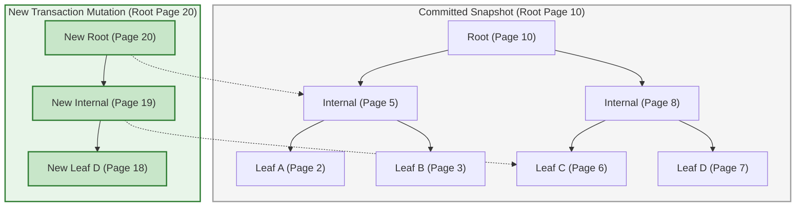
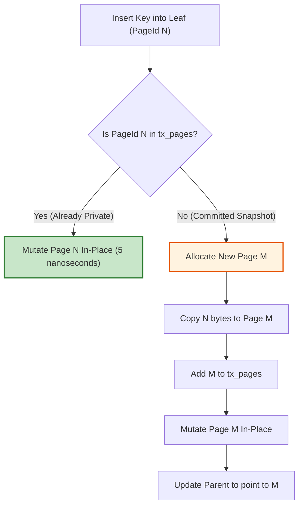

# Copy-On-Write (COW) B+ Tree Engine

The indexing engine (`tej-db-btree`) provides a crash-safe, append-only, Copy-on-Write (COW) B+ Tree index with sub-microsecond point reads, multi-million ops/s batch writes, and streaming range scan cursors.

---

## 1. Copy-On-Write Structural Invariant

In standard mutable B-trees, updates overwrite disk blocks in-place, risking database corruption if a sudden power loss occurs mid-write.

In **TejDb**, pages on disk and in committed buffer frames are **immutable**. When an update occurs:
1. The target leaf page is copied to a newly allocated `PageId`.
2. The modification is applied to the new page.
3. The parent internal node is copied to point to the new leaf `PageId`.
4. This path-copying cascades up to the root, generating a new root `PageId`.



**Key Benefit**: The old root (`Page 10`) remains completely unmodified on disk and in memory. Concurrent reader transactions can read the snapshot without taking any locks or interfering with active writers.

---

## 2. Fast-Path: In-Place Mutation of Private Transaction Pages (`tx_pages`)

Pure Copy-On-Write suffers from write amplification if a transaction inserts 1,000 keys into the same leaf: naive COW would allocate 1,000 separate pages and cascade roots 1,000 times!

To solve this, `BTreeIndex` maintains a transaction-private set of dirty pages:
```rust
pub type TxPageSet = HashSet<PageId, FastPageIdBuildHasher>;
```

### The In-Place Fast Path:
When inserting into a leaf:
1. Check if `current_leaf_id` is present in `tx_pages`.
2. **If present**: The leaf was *already allocated by this transaction* and is not visible to any snapshot reader. The DBMS directly mutates the page in-place using `leaf_insert_raw_inplace`.
3. **If not present**: The leaf is copied to a newly allocated `PageId`, added to `tx_pages`, and then mutated.



**Impact**: Amortizes write amplification from $O(K \cdot \log N)$ to $O(\log N)$ per transaction batch, powering bulk sequential throughput past **5.2M ops/s**.

---

## 3. Node Splitting & Merging

When an in-place insert fails because free space is exhausted, the leaf splits:
1. A new sibling leaf `PageId` is allocated.
2. The upper half of the slots and cells are transferred to the sibling.
3. The linked list pointers (`next_leaf` / `prev_leaf`) are updated atomically.
4. The boundary separator key and sibling `PageId` are propagated upward into the parent internal node.
5. If the parent internal node is full, it splits recursively. If the root splits, a new root internal node is allocated, increasing the tree depth by 1.

---

## 4. Streaming Range Scan Cursors (`scan_range_visitor`)

Rather than materializing full vectors of key-value pairs on the heap, `BTreeIndex` provides a zero-allocation cursor visitor:

```rust
pub fn scan_range_visitor(
    &self,
    range: &KeyRange,
    mut visitor: impl FnMut(&[u8], &[u8]) -> Result<bool>,
) -> Result<()>
```

### Traversal Mechanics:
1. Performs a binary-search tree descent to locate the first leaf containing `range.start`.
2. Inspects slots sequentially within the page, invoking the closure directly on `(&[u8], &[u8])` slices in page memory.
3. When the end of the leaf is reached, follows the `next_leaf` pointer directly to the adjacent leaf.
4. Terminates immediately when `visitor` returns `Ok(false)` or `range.end` is exceeded.

**Performance**: Sustains over **20,000,000 items/sec** during sequential range iteration.
