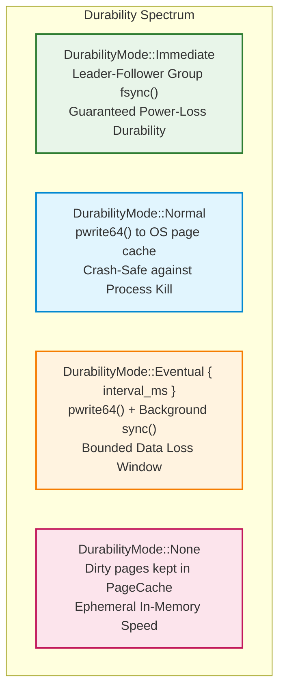
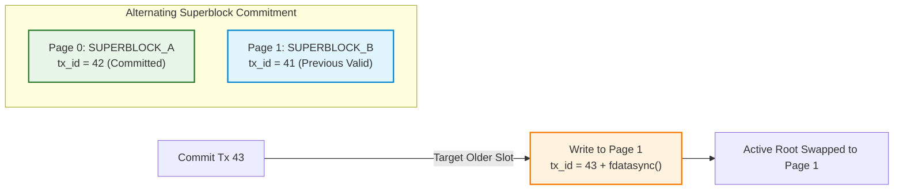
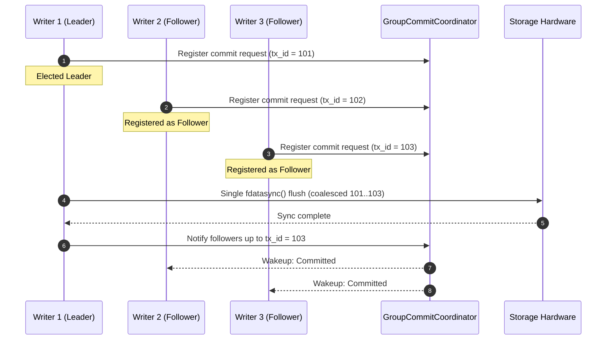
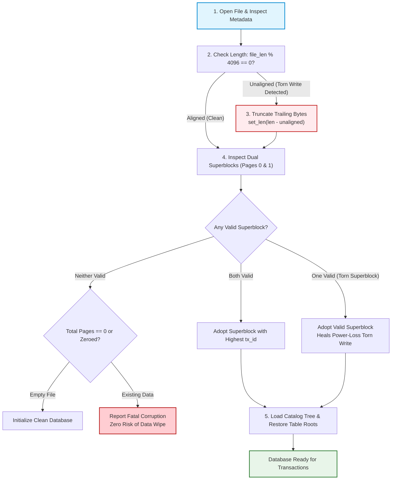
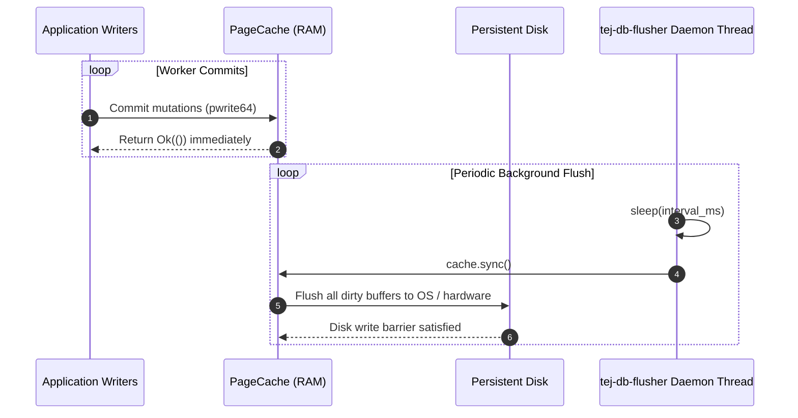

# Durability Modes & Crash Recovery

TejDb provides configurable durability tiers balancing ACID persistence guarantees against raw write performance. This document details the 4-tier durability spectrum, the Dual Ping-Pong Superblock architecture, Leader-Follower Group Commit, the torn-write repair protocol, and power-loss recovery mechanics.

---

## 1. The Durability Spectrum

Durability is parameterized via the `DurabilityMode` enum:

```rust
pub enum DurabilityMode {
    Immediate,
    Normal,
    Eventual { interval_ms: u64 },
    None,
}
```



### Operational Characteristics

| Durability Tier | Commit Flush Behavior | Survival Guarantee | Target Workload |
| :--- | :--- | :--- | :--- |
| **`Immediate`** | Leader-Follower Group Commit: Coalesces concurrent writers into shared `fdatasync()` / barrier. | Tolerates sudden OS kernel panic, power outage, or hardware failure. | Financial ledgers, high-consequence transaction systems. |
| **`Normal`** | Writes dirty pages to storage file (`pwrite64`), returns immediately without synchronous `fsync()`. | Tolerates application crash or `SIGKILL`. Tolerates power outage up to OS sync interval. | General database applications, high-throughput microservices. |
| **`Eventual { interval_ms }`** | Writes dirty pages to storage file; dedicated `tej-db-flusher` background thread calls `sync()` at set intervals. | Tolerates application crash. Upper bound on power-loss data loss is `interval_ms`. | Metrics telemetry, time-series, log ingestion. |
| **`None`** | No storage writes on commit; dirty pages stay in RAM buffer pool until evicted or shutdown. | Process-lifetime only unless explicit `db.flush()` is called. | Unit testing, ephemeral caching, analytical scratchpads. |

---

## 2. Dual Ping-Pong Superblock Architecture (Page 0 & Page 1)

In shadow-paging and Copy-on-Write engines (such as LMDB and Redb), overwriting a single root meta page in-place introduces a catastrophic torn-write window: if power is interrupted mid-write, the root checksum fails, leading to unrecoverable database loss.

To eliminate this vulnerability, TejDb reserves **Page 0 (`SUPERBLOCK_A`)** and **Page 1 (`SUPERBLOCK_B`)** as alternating ping-pong superblocks.



### Binary Layout (4,096 Bytes)

```
+-------------------------------------------------------------------------------+
|                       Slotted Page Header (64 Bytes)                          |
|  PageType::Meta (0x04) | Checksum (CRC32C) | LSN | Free Space Offset          |
+-------------------------------------------------------------------------------+
| Bytes 0..4   : Magic Bytes ("TEJ_DB")                                           |
| Bytes 4..8   : Version (CURRENT_DB_VERSION = 2)                               |
| Bytes 8..16  : Active Root PageId (Little-Endian u64)                         |
| Bytes 16..24 : Catalog Root PageId (Dynamic B+ Tree Catalog Root)             |
| Bytes 24..32 : Next Transaction ID (Monotonic Little-Endian u64)              |
| Bytes 32..34 : Table Directory Inline Count (Reserved for Fast Path)          |
+-------------------------------------------------------------------------------+
| Inline Table Directory Cache (Up to Header Limit)                             |
| Dynamic Catalog B+ Tree manages infinite tables beyond the 4 KiB header limit  |
+-------------------------------------------------------------------------------+
| Unused Reserved Payload (Padded to 4,096 Bytes)                               |
+-------------------------------------------------------------------------------+
```

### Ping-Pong Slot Selection & Recovery Protocol
1. **Commit Slot Selection**: Every write transaction inspects the current active superblock slot. It writes the newly committed transaction metadata (`active_root`, `catalog_root`, `next_tx_id + 1`) to the *alternate* superblock slot, issues `fdatasync()`, and only then publishes the active slot index via an `AtomicU64`.
2. **Crash & Power-Loss Recovery**:
   - Both `SUPERBLOCK_A` (Page 0) and `SUPERBLOCK_B` (Page 1) are read and validated for CRC32C checksum and magic header bytes.
   - If a torn write occurred while updating one slot during sudden power loss, that slot's CRC32 checksum fails. TejDb seamlessly adopts the other valid slot containing the previous consistent database state.
   - If both slots are valid, the engine selects the slot with the higher `next_tx_id`.
   - Never falls back to initializing a clean database if existing data is present.

---

## 3. Dynamic Catalog Root B+ Tree Migration

In early versions, the table catalog was constrained inside the 4 KiB payload of Page 0, imposing a hard ceiling on table count and sharded partitions.

TejDb decouples table definitions from superblock limits by storing the table catalog inside a dedicated Copy-on-Write B+ Tree (`catalog_root`):
- **Unlimited Tables & Shards**: System tables, user tables, and intra-table partitions are stored as dynamic entries in the catalog B+ Tree.
- **Fast-Path Inline Caching**: The most frequently accessed table roots remain cached in the superblock header for instant bootstrap without extra I/O hops.
- **ACID DDL**: `CREATE TABLE` and `DROP TABLE` modify the catalog tree within the same atomic commit boundary as user data mutations.

---

## 4. Leader-Follower Group Commit (`DurabilityMode::Immediate`)

Synchronous `fsync()` / `fdatasync()` calls incur severe latency penalties under heavy concurrent write loads (dropping throughput on virtualized and Docker filesystems).

TejDb addresses this with **Leader-Follower Group Commit**:


Concurrent writers entering the commit phase register their pending transaction ID into a lock-free queue. The first writer becomes the group leader and executes a single storage sync barrier (`fdatasync`). All waiting followers are notified and return success in a single round-trip, amortizing disk barrier costs over dozens of concurrent transactions.

---

## 5. Crash Recovery & Torn-Write Healing

A torn write occurs when power is severed midway through writing a sector, leaving trailing partial bytes at the file boundary.

### Recovery Workflow (`Database::recover_file`)



---

## 6. Background Flusher Mechanics (`tej-db-flusher`)

When running in `DurabilityMode::Eventual { interval_ms }`, a background daemon thread maintains periodic disk synchronization without blocking worker threads:



The flusher thread uses an atomic stop flag (`AtomicBool`) to cleanly finish any in-flight disk sync operations upon database shutdown or mode reconfiguration.
