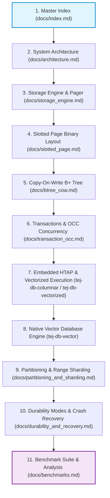

# Modular ACID DBMS Documentation

Welcome to the technical documentation for **TejDb**, a high-performance, crash-safe, embedded ACID database management system written in pure Rust.

This documentation is organized progressively from **high-level conceptual architecture** down to **low-level binary formats and lock-free algorithmic implementations**.

---

## Documentation Roadmap (General to Specific)

---

## Document Index

### 1. High-Level Architecture & Philosophy
* **[System Architecture](architecture.md)**:
  - Crate decomposition across the workspace (`tej-db-core`, `tej-db-pager`, `tej-db-btree`, `tej-db-txn`, `tej-db-vector`, `tej-db-columnar`, `tej-db-vectorized`, `tej-db-sql`, `tej-db-cli`).
  - Dual-engine architecture: unified B+ tree row-store for OLTP transactions and hybrid columnar row-groups with vectorized SIMD operators for OLAP analytics.
  - Core design principles: Zero-Copy, Zero-Allocation hot paths, No-Panic invariant enforcement.

### 2. Physical Storage & Virtual File System (VFS)
* **[Storage Engine & Buffer Pool](storage_engine.md)**:
  - 16-way sharded buffer pool cache (`PageCache`) with scan-resistant S3-FIFO eviction (Small, Main, Ghost queues).
  - Multi-backend storage abstraction: `FileStorage` (`pread64`/`pwrite64`), `MemStorage`, and `MmapStorage` with `ZeroCopyPageView` direct memory slicing.
  - Hardware SIMD-accelerated CRC32C verification (`crc32fast` / SSE4.2 / ARMv8).
  - Lock-free batched storage page pre-allocation (`allocator.rs`).
  - Transparent storage transforms: line-rate LZ4 compression and ChaCha20-Poly1305 hardware encryption.

### 3. Binary Page Architecture
* **[Binary Slotted Page Layout](slotted_page.md)**:
  - Slotted page structure, 64-byte aligned SIMD header, item count, free space pointer.
  - Reverse slot directory layout and variable-length key-value cell format.
  - Dedicated `PageType::VectorNode` (0x05) page format for page-aligned DiskANN (Vamana) graph adjacency lists ($R = 32..64$) and 1/2-bit RaBitQ compressed codes.
  - In-place raw leaf updates (`leaf_insert_raw_inplace`) vs COW page allocation.
  - Multi-page overflow chains for streaming BLOB payloads up to 16 MiB.

### 4. Indexing & Tree Traversal
* **[Copy-On-Write B+ Tree Engine](btree_cow.md)**:
  - Root-to-leaf descent with zero-copy cache page borrowing.
  - Private transaction page set (`tx_pages`) preventing cascading leaf duplications.
  - Dynamic Table Catalog B+ Tree root removing the 4 KiB metadata header ceiling.
  - High-throughput streaming range scan cursors.

### 5. ACID Concurrency & Transactions
* **[Transactions, Snapshot Isolation & OCC](transaction_occ.md)**:
  - Optimistic Concurrency Control (OCC) lifecycle: Begin -> Private Staging -> Lock -> Validate -> Atomic Root Publish.
  - Dual Ping-Pong Superblocks (Page 0 and Page 1) preventing torn-write corruption.
  - LMAX Disruptor lock-free Ring Buffer for Same-Table Write Combining and Leader-Follower Group Commit.
  - Lock-free table roots using `AtomicU64` in `TableCatalog`.
  - Transaction savepoints (`savepoint()`, `rollback_to_savepoint()`, `release_savepoint()`).
  - Per-table commit histories and isolated adaptive spinlocks eliminating multi-table contention.

### 6. Embedded HTAP & Vectorized Execution (DuckDB & SQLite Parity)
* **[Columnar Storage & Vectorized Execution](architecture.md#5-embedded-htap--vectorized-execution-engine-tej-db-columnar--tej-db-vectorized)**:
  - Hybrid Columnar Row-Groups (`tej-db-columnar`) with SIMD-aligned `ColumnVector` and 2,048-row `DataChunk` morsels.
  - Lightweight codecs: BitPacking (FoR, 76M rows/s), Run-Length Encoding (RLE, 1.07B rows/s, 664× compression), Dictionary encoding.
  - ZoneMap block skipping enabling $O(1)$ pruning of unneeded column row-groups.
  - Vectorized query execution (`tej-db-vectorized`): SIMD filter bitmasks, batch projections, group-by hash aggregates (21.9M rows/s), and hash joins (21.3M rows/s).
  - Multi-core Morsel-Driven execution (`MorselScheduler`) and out-of-core $k$-way merge sorting (`SpillableBuffer`).
  - SQLite parity: `Decimal`, `Uuid`, `Timestamp`, `Interval`, `Json`, `CHECK`, `FOREIGN KEY`, `ON CONFLICT DO UPDATE`, `RETURNING`.
  - Cost-Based Optimizer (`tej-db-sql::cbo`): HyperLogLog, 64-bucket histograms, join ordering, and adaptive execution router.

### 7. Native Vector Database Engine (DiskANN & RaBitQ)
* **[Vector Engine Architecture](architecture.md#3-native-vector-database-engine-tej-db-vector)**:
  - Page-aligned DiskANN (Vamana) single-layer graph with L2-resident `VectorArena` and medoid entry point.
  - RaBitQ 1-bit and 2-bit quantization with Fast Walsh-Hadamard Transform (FWHT, $O(D \log D)$ energy dispersal, 125× speedup).
  - 100% Recall@10 on 768-dim embeddings and 128-dim vectors via oversampled full-precision reranking.
  - FreshDiskANN ACID delta buffer with background compaction.
  - Hybrid SQL search with Roaring Bitmap pre-filtering.

### 8. Table Separation & Intra-Table Partitioning
* **[Partitioned Tables & Range Sharding](partitioning_and_sharding.md)**:
  - Domain separation: distinct B+ tree root Page IDs per table.
  - Range-based intra-table sharding via `ShardedTableDescriptor`.
  - Binary search key routing and streaming cross-shard cursor iterators.
  - Instant $O(1)$ table drops and schema alterations.

### 9. Durability & Disaster Recovery
* **[Durability Modes & Crash Recovery](durability_and_recovery.md)**:
  - The 4-tier durability spectrum: `Immediate` (fsync), `Normal` (OS disk flush), `Eventual` (background flusher), and `None` (ephemeral).
  - Torn-write detection and automatic boundary repair on database reopen.
  - Meta Page 0 versioning (V1 and V2) and atomic two-phase commit verification.

### 10. Empirical Performance & Benchmarks
* **[Comprehensive Benchmark Report](benchmarks.md)**:
  - Native Bare-Metal vs Isolated Docker Container (`--cpus=4 --memory=4g`) empirical results.
  - Comparative analysis against Redb and SQLite (WAL).
  - Stress testing: YCSB-B Zipfian skew, cache starvation, noisy neighbors, and disaster simulations.
