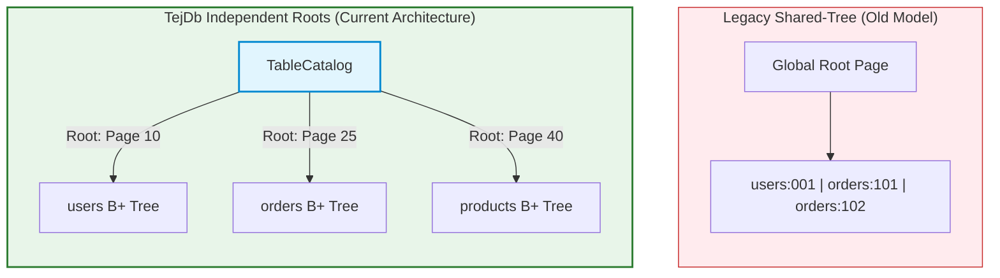
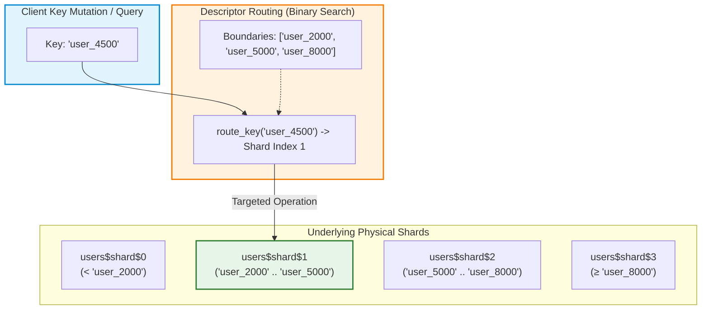
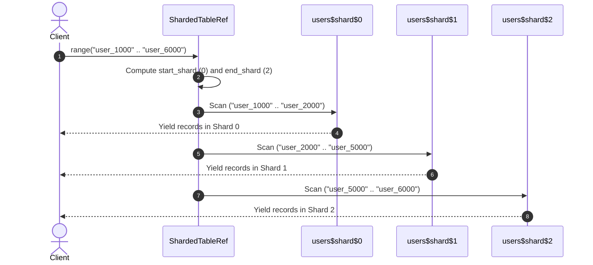
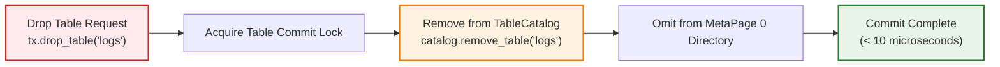

# Partitioned Tables & Range Sharding

TejDb provides two layers of data isolation and parallelism:
1. **Independent Table Roots**: Every logical table owns an independent B+ Tree with its own root `PageId`, eliminating the legacy shared-root key prefix overhead.
2. **Intra-Table Range Sharding**: High-volume tables can be transparently partitioned across multiple sub-trees using user-defined range boundaries.

---

## 1. Architectural Motivation

In early shared-root database designs, all tables resided in a single monolithic B+ Tree with composite keys formatted as `[table_prefix | user_key]`. This introduced major inefficiencies:
- **Key Prefix Bloat**: Every entry carried 8 to 16 bytes of redundant prefix data, reducing 4 KiB slotted page leaf capacity by up to 30%.
- **Cascading Root Contention**: Concurrent writes to completely unrelated tables (e.g. `users` and `orders`) competed for the same root page, forcing serialization.
- **$O(N)$ Table Deletion**: Dropping a table required scanning and physically deleting every single row in the tree.

TejDb solves these issues with **Independent Root B-Trees** and **Range-Based Sub-Tree Sharding**.



---

## 2. Intra-Table Range Sharding Architecture

When a single table experiences write bottlenecks across different key regions, it can be partitioned using a `ShardedTableDescriptor`.



### Physical Shard Representation
Each shard is managed as a standalone, first-class table in the database:
- Shard table name: `{table_name}$shard${shard_idx}`
- Each shard owns an independent `TableCatalogEntry`, an independent `AtomicU64` root, and an isolated `AdaptiveSpinLock`.
- Writers targeting different key ranges of the same logical table execute fully in parallel across separate CPU cores without lock contention.

---

## 3. ShardedTableDescriptor Specification

Range partitioning is defined by the `ShardedTableDescriptor` struct:

```rust
pub struct ShardedTableDescriptor {
    pub name: String,
    pub num_shards: usize,
    pub boundaries: Vec<Vec<u8>>,
}
```

### Invariants & Validation
1. **Shard Count**: `num_shards >= 1`.
2. **Boundary Count**: Exactly `num_shards - 1` boundaries must be provided.
3. **Strict Ordering**: Shard boundaries must be strictly ascending:
   $$\text{boundary}[0] < \text{boundary}[1] < \dots < \text{boundary}[N-2]$$
4. **Binary Search Routing**: Point queries locate the destination shard in $O(\log K)$ time without linear boundary scanning:
   ```rust
   pub fn route_key(&self, key: &[u8]) -> usize {
       if self.boundaries.is_empty() {
           return 0;
       }
       match self.boundaries.binary_search_by(|b| b.as_slice().cmp(key)) {
           Ok(idx) => idx + 1,
           Err(idx) => idx,
       }
   }
   ```

---

## 4. Cross-Shard Streaming Range Scans

Querying a range across multiple partitions is executed transparently via `ShardedTableRef::range`.



The iterator streams records lazily. Shard sub-trees are opened on demand, ensuring minimal cache footprint during broad range scans.

---

## 5. Schema & Descriptor Persistence

Sharding topologies are durably persisted in the internal system metadata table:
- Table name: `__tej_db_shards__` (`SHARDS_META_TABLE`)
- **Key**: Table name (e.g. `"orders"`)
- **Value**: Binary encoded descriptor:
  - `[0..2]`: `num_shards` (Little-Endian `u16`)
  - `[2..4]`: `boundary_count` (Little-Endian `u16`)
  - Sequence of boundaries: `[len: u16, raw_bytes: [u8; len]]`

When the database restarts, the transaction manager reloads registered descriptors and binds the logical partitions to their corresponding physical B+ trees.

---

## 6. O(1) Instant Table Drops

Dropping a table or dropping an entire sharded partition set is an **$O(1)$ constant-time operation**:



Instead of traversing and deleting gigabytes of leaf pages, `drop_table` simply unregisters the table from the in-memory catalog and excludes it from the persistent `MetaPage` table directory. Historical pages are unreferenced and reclaimed by the page vacuum manager.
