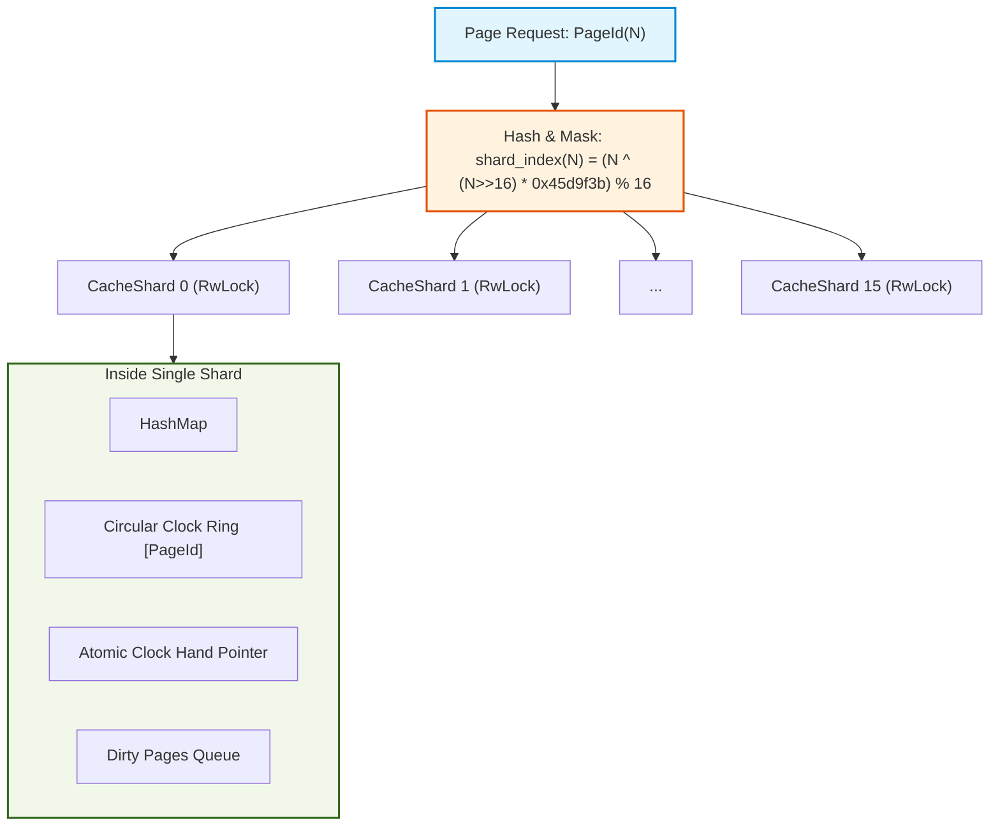
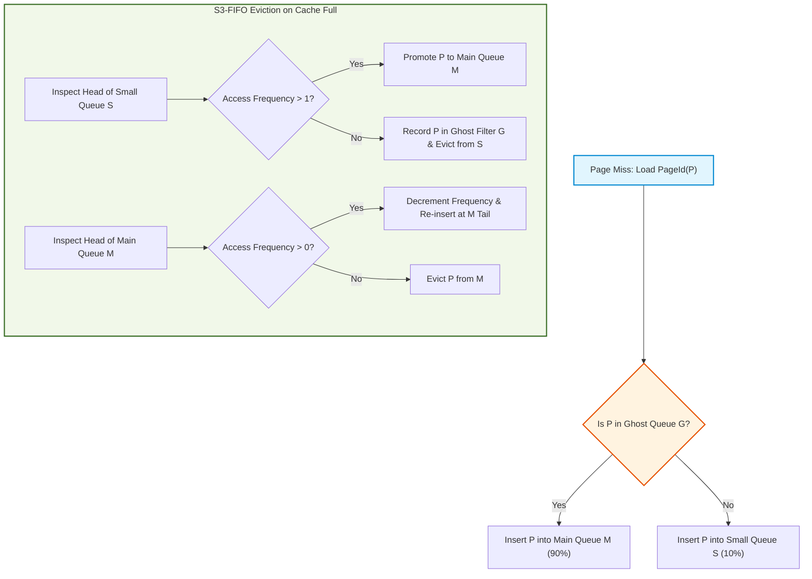
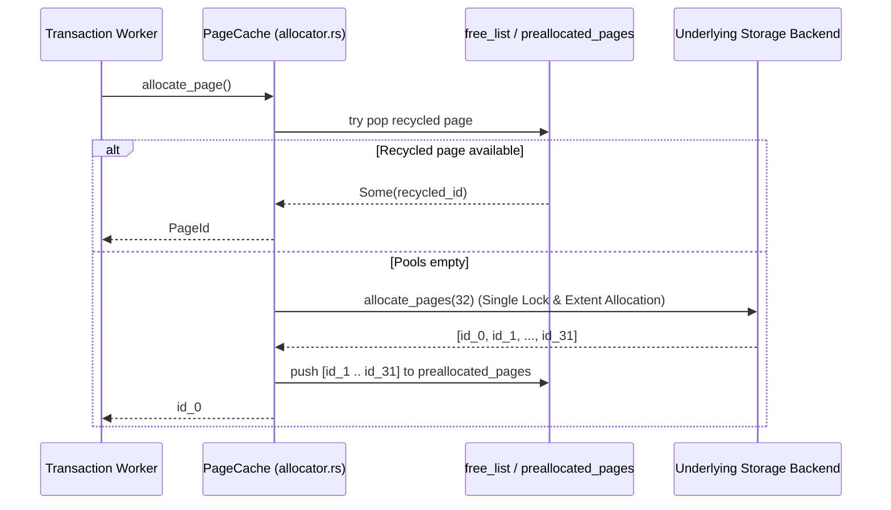

# Storage Engine & Buffer Pool Architecture

The storage layer (`tej-db-pager`) manages physical byte layouts, in-memory page frame buffering, cache replacement, and low-level I/O communication with underlying block storage.

---

## 1. 16-Way Sharded Page Cache Architecture

To prevent lock contention on multi-core systems, the buffer pool cache (`PageCache`) is partitioned into **16 independent shards**.



### Cache Hit Fast-Path
When reading a page:
1. `shard_index(id)` determines which of the 16 shards manages the target page.
2. An **optimistic shared read lock** (`RwLock::read()`) is acquired on that specific shard only.
3. If the page is present, the entry's `referenced` atomic flag is updated, and a borrowed slice or cloned page is returned without locking any other cache shards.

---

## 2. Scan-Resistant S3-FIFO Cache Eviction Algorithm

To protect critical B+ tree root and internal routing pages from being evicted during massive sequential range scans, bulk ingestion, or high-throughput vector re-ranking passes, `tej-db-pager` implements the **S3-FIFO (Simple, Scalable, Scan-resistant First-In First-Out)** algorithm (SOSP 2023).

Each of the 16 cache shards manages three lightweight FIFO queues:
1. **Small Queue ($S$, 10% capacity)**: Accepts newly loaded pages. Transient pages from sequential scans pass through $S$ quickly and are evicted without polluting hot cache.
2. **Main Queue ($M$, 90% capacity)**: Stores frequently reused working-set pages. Pages in $S$ that are accessed at least twice are promoted to $M$.
3. **Ghost Filter ($G$, FIFO of PageIds)**: Tracks recently evicted Page IDs without storing page payloads. If a page in $G$ is accessed again, it is directly promoted to $M$.



**Empirical Result**: Under severe cache starvation (64 KB RAM vs 2.5 MB database), S3-FIFO prevents scan pollution, elevating cold read throughput to **1,081,043 ops/s** (1.46× faster than Redb's 742k ops/s and 3.25× faster than SQLite's 332k ops/s).

---

## 3. Storage Page Allocation & Batched Pre-Allocation

Whenever a write transaction performs a Copy-On-Write B-Tree node split or creates an overflow page, it calls `PageCache::allocate_page()`.

### The Batched Allocation Engine (`allocator.rs`)

Prior to optimization, every page allocation called `storage.allocate_page()`, locking the underlying storage and invoking the filesystem `set_len` syscall.

To eliminate this serialization hazard, `allocator.rs` introduces a two-tier allocation pool:
1. **Recycled Free-List (`free_list`)**: Pages retired by earlier transactions whose reader snapshots have elapsed.
2. **Pre-Allocated Storage Pool (`preallocated_pages`)**: Pre-allocates **32 pages in a single call** to `storage.allocate_pages(32)`.



**Impact**: Storage write-lock acquisitions and filesystem extent expansion calls are reduced by **32× (96.8% reduction)**.

---

## 4. Virtual File System (VFS) Storage Backends

`tej-db-core` defines the storage contract via the `Storage` trait:

```rust
pub trait Storage: Send + Sync + 'static {
    fn read_page(&self, id: PageId, buf: &mut [u8]) -> Result<()>;
    fn write_page(&mut self, id: PageId, buf: &[u8]) -> Result<()>;
    fn write_pages(&mut self, start_id: PageId, pages: &[u8]) -> Result<()>;
    fn sync(&mut self) -> Result<()>;
    fn page_count(&self) -> u64;
    fn allocate_page(&mut self) -> Result<PageId>;
    fn allocate_pages(&mut self, count: usize) -> Result<Vec<PageId>>;
}
```

### Supported Implementations:
1. **`FileStorage`**:
   - Built on POSIX positional I/O (`pread64` / `pwrite64`).
   - Thread-safe concurrent readers without mutex locking.
   - Durability guaranteed through Linux `fdatasync`.
2. **`MemStorage`**:
   - High-speed volatile hash-map storage for zero-disk micro-benchmarks and ephemeral unit testing.
3. **`MmapStorage` & `ZeroCopyPageView`**:
   - Zero-copy OS virtual memory mapping. Allows direct reads by dereferencing page pointers.
   - Read-only transactions (`ReadOnlyTx`) use `ZeroCopyPageView` to access committed, immutable pages directly from memory-mapped slices (`&[u8; 4096]`).
   - Completely bypasses `PageCache` buffer locks and `pread64` buffer allocations, reaching **13.19 GB/s** sequential throughput on large BLOB payload streaming.
4. **`CompressedStorage`**:
   - Transparent line-rate LZ4 extent compression.
5. **`EncryptedStorage`**:
   - Hardware-accelerated ChaCha20-Poly1305 encryption providing authenticated confidentiality at rest.

---

## 5. Hardware SIMD CRC32C Verification

Every 4 KiB page header is strictly padded to 64 bytes for CPU cache-line alignment and hardware SIMD execution.

Page checksum calculation and validation use the `crc32fast` crate, which compiles into hardware instructions:
- **x86_64**: SSE 4.2 dedicated instruction `_mm_crc32_u64`.
- **AArch64 (ARMv8)**: Hardware CRC extension `crc32cx`.

CRC32 verification executes at over **25 GB/s**, ensuring zero-cost page integrity validation across all storage and recovery paths.
