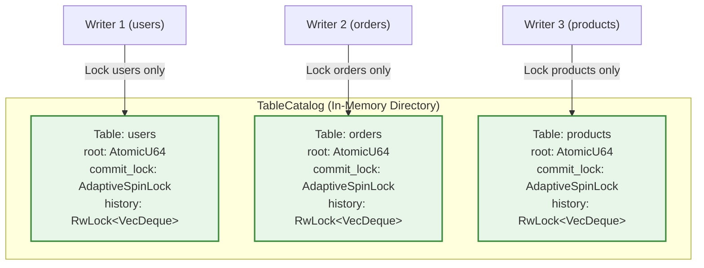
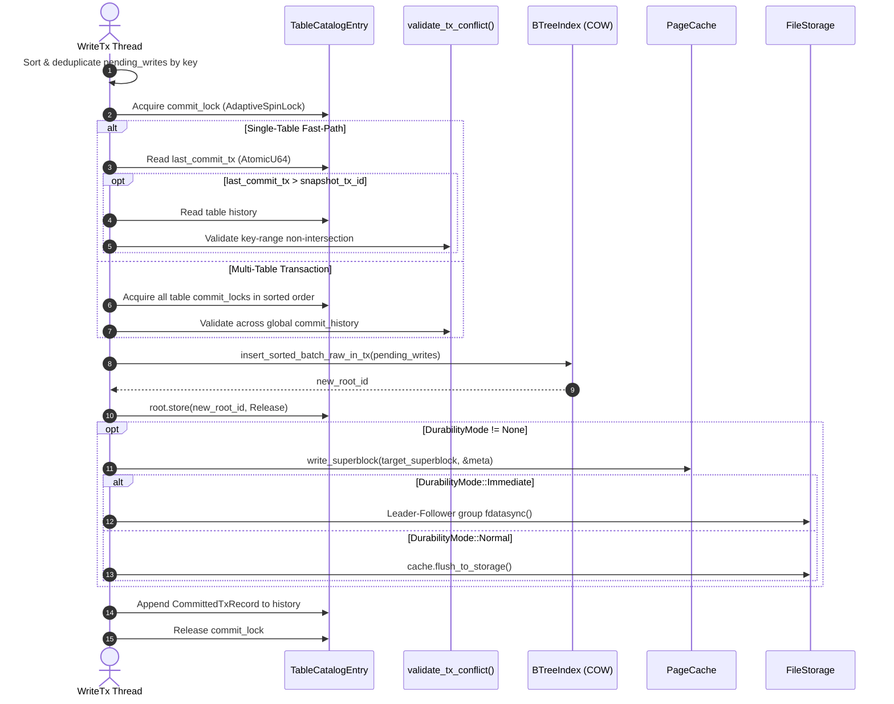
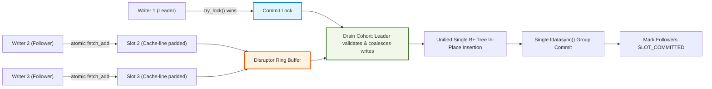

# Transactions & Optimistic Concurrency Control (OCC)

TejDb implements **Snapshot Isolation (SI)** via a decoupled **Optimistic Concurrency Control (OCC)** engine. The design guarantees that read transactions never block write transactions, write transactions execute lock-free during their computation phase, and commits achieve high throughput using fine-grained per-table spinlocks and lock-free atomic root pointers.

---

## 1. Concurrency Control Architecture

Traditional embedded databases rely on coarse database-level exclusive locks (e.g. SQLite's single-writer lock) or heavyweight page-level two-phase locking (2PL). In contrast, TejDb separates transaction execution into three distinct phases:


1. **Read & Execution Phase**: The transaction takes an atomic snapshot of the current transaction counter (`snapshot_tx_id`) and table root page IDs. All mutations (`insert`, `delete`) are buffered privately in thread-local transaction memory (`TableTxState.pending_writes`). No shared data structures are locked, and no disk writes occur.
2. **Validation Phase**: At commit time, the transaction acquires fine-grained commit locks only for the tables it modified. It verifies that no concurrent transaction committed conflicting writes to the same key ranges after its snapshot was established.
3. **Atomic Commit Phase**: The transaction batch-applies its mutations into the Copy-On-Write B+ Tree, updates the catalog roots via a single lock-free `AtomicU64::store(Release)`, and persists the new state according to the configured durability mode.

---

## 2. Lock-Free Table Roots & Independent Commit Locks

To enable linear write scaling across independent tables, TejDb eliminates all global locks from the commit hot path.



### TableCatalogEntry Structure
Each registered table maintains an isolated `TableCatalogEntry`:
- **`root: AtomicU64`**: The current active root Page ID. Updating a table's root requires only a single `store(Release)` operation with zero write-lock contention.
- **`commit_lock: AdaptiveSpinLock`**: A fine-grained spinlock protecting serial commits to this specific table. Transactions writing to different tables never contend on locks.
- **`history: RwLock<VecDeque<CommittedTxRecord>>`**: A ring buffer of recently committed transactions on this table, used for localized OCC validation.
- **`last_commit_tx: AtomicU64`**: The transaction ID of the last commit touching this table.

---

## 3. Transaction State Machine

A transaction progresses through strict state transitions managed by `WriteTx`:

```mermaid
stateDiagram-v2
    [*] --> Active: begin_write()
    Active --> Staging: insert() / delete()
    Staging --> Staging: batch mutations
    Staging --> Locking: commit()
    Locking --> Validating: acquire table locks
    Validating --> Aborted: OCC conflict detected
    Validating --> TreeMutation: validation passed
    TreeMutation --> RootPublish: insert batch to COW tree
    RootPublish --> DurabilityFlush: AtomicU64::store
    DurabilityFlush --> Committed: fsync / storage write
    Aborted --> [*]
    Committed --> [*]
```

---

## 4. OCC Commit & Validation Sequence

The commit protocol ensures serializability while maximizing concurrent throughput:



---

## 5. Deadlock Prevention: Canonical Lock Ordering

When a transaction touches multiple tables (or alters catalog metadata), locking multiple tables could lead to classic AB/BA deadlocks. 

TejDb guarantees **deadlock-free multi-table commits** through canonical sorting:

```rust
// 1. Identify all affected tables
let mut lock_tables: Vec<String> = self
    .table_states
    .iter()
    .filter(|s| !s.pending_writes.is_empty() || self.created_tables.iter().any(|t| t == &s.name))
    .map(|s| s.name.clone())
    .chain(self.created_tables.iter().cloned())
    .chain(self.dropped_tables.iter().cloned())
    .collect();

// 2. Canonical lexicographical sort ensures zero cycles in lock acquisition graph
lock_tables.sort();
lock_tables.dedup();

// 3. Acquire locks in strictly ascending order
let _guards = lock_tables.iter().map(|tbl| {
    self.manager.catalog.get_table_entry(tbl).unwrap().commit_lock.lock()
}).collect::<Vec<_>>();
```

---

## 6. Single-Table Validation Fast-Path

For transactions modifying only a single table, the global commit lock and global history are completely bypassed:

1. **Zero-Contention Validation Check**:
   ```rust
   let needs_validation = entry.last_commit_tx.load(Ordering::Acquire) > self.snapshot_tx_id.0;
   ```
   If no other transaction committed to this table since our snapshot, **validation takes zero cycles**—no locks, no scans.
2. **Localized History Search**:
   If concurrent commits did occur on this table, only that table's local history ring buffer is searched. Unrelated tables never experience cache line invalidations or lock contention.

---

## 7. Read Transactions & Lock-Free Snapshot Isolation

Read-only transactions (`ReadOnlyTx`) are completely non-blocking:
- `begin_read()` captures an atomic snapshot of `active_root` and `catalog.snapshot()`.
- Reader threads increment an active reader counter (`cache.acquire_reader()`) to prevent concurrent vacuuming of historical pages.
- Reads traverse immutable historical B+ Tree pages via Copy-On-Write guarantees. Readers never block writers, and writers never block readers.

---

## 8. Leader-Follower Group Commit & Write-Combining Queue

When multiple concurrent writer threads commit mutations to the database, contention on the commit lock is converted into automatic batching via an **LMAX Disruptor-style lock-free ring buffer** (`crates/tej-db-txn/src/ring_buffer.rs`):



1. **Lock-Free Ticket Reservation**: Contending followers reserve a cache-line padded `IngestSlot` via `head.fetch_add(1, Relaxed)` and stage their sorted writes.
2. **Unified B+ Tree Coalescing**: The leader drains up to 512 pending slots, validates OCC conflicts in a single read lock over `commit_history`, merges all approved mutations into a contiguous vector, and applies them to the B+ tree in a single pass.
3. **Group Durability Sync**: One `fdatasync()` flushes the combined transactions for the leader and all followers simultaneously, completely overcoming filesystem sync bottlenecks under heavy concurrency.

---

## 9. Dual Ping-Pong Superblocks (Pages 0 & 1)

To completely eliminate the single-page torn-write corruption vulnerability of traditional engines, TejDb alternates metadata writes between **Page 0** and **Page 1**:
- Each commit writes to the older or inactive superblock slot (`choose_commit_superblock(cur_sb, next_tx_id)`).
- On database startup or crash recovery, both Page 0 and Page 1 are read and verified via SIMD CRC32C checksums. The superblock with the higher valid `tx_id` is adopted as active.
- If an abrupt power loss tears a write mid-page, the alternate superblock remains 100% intact, guaranteeing zero-loss crash recovery.
- If both superblocks are corrupt, recovery enters `FatalCorrupt` mode, refusing to auto-wipe data.
